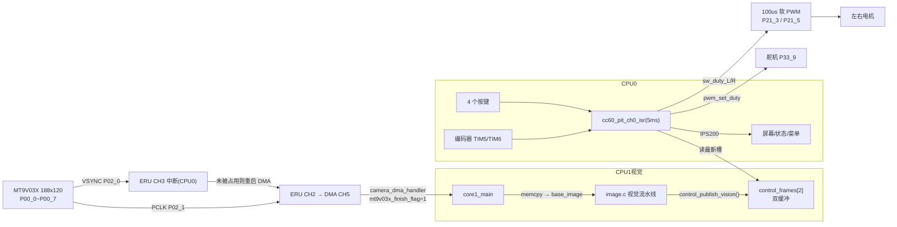

# E8_08 智能车工程架构说明

> 平台：Infineon **TC264D**（AURIX TC26x，双核 TriCore）+ 逐飞（SEEKFREE）开源库
> 开发环境：AURIX Development Studio（Eclipse/ADS，工程文件 `.cproject`）
> 传感器：**MT9V03X** 摄像头，188 × 120 灰度图
> 场景：摄像头巡线，5 ms 控制周期
> 文档更新时间：2026-11-15

---

## 更新日志

### 2026-11-20 ・ 急弯基点查找失败修复（冲出弯道）
- 现象：弯道里找不到基点，中线直接变直线，车冲出弯道。
- 原因：`find_jidian` 原从图像中心向两侧找左右边线，默认赛道横跨中心；急弯时赛道整体偏到一侧，中心另一侧无赛道 → 找不到边线 → 兜底用过期基点。
- 修复：左右边线改为**全行扫描**（左边界取最左 黑→白，右边界取最右 白→黑）；找不到基点时保持上一帧 `search_top_row`，不再硬跳回 109。

### 2026-11-20 ・ 摄像头抬高 → 中线目标值修正（MID_W 93→83）
- 抬高摄像头后，车在赛道正中间直行时视觉中线稳定在 **83**（原 93），导致 `err = MID_W - mid = +10` 持续打舵 → 车贴左跑。
- 将 `MID_W` 从 93 改为 83（`image.h`），使控制目标等于“车直行时的实际视觉中线值”。
- 舵机中值 `duoji_mid` 未变，开机回中逻辑（`init.c` 的 `pwm_init(duoji_jiao, 50, duoji_mid)`）仍然存在。
- 新增中线加权参数 `mid_weight_ratio`（菜单 `MW_RATIO`，默认 0.30）解决提前打弯；新增前馈速度缩放 `STEER_FF_GAIN_SPD`（菜单 `FF_SPD`，默认 0.25）。

### 2026-11-15 ・ 元素 FSM：直行1/拐弯2/十字3/环岛4~8
- 元素判断改为**严格 FSM**：`zt1` 直行、`zt2` 拐弯、`zt3` 十字、`zt4~zt8` 环岛五个阶段。
- 入环更严：单侧连续丢线 ≥ `R_LOSS`，且**近端拐点**在下方（y ≥ `NEAR_ROW`，排除远处弯道），对侧不丢长线，才进 `zt4`。
- 完整环岛流程：`zt4` 近端拐点拉线 →（丢线边底部丢线）→ `zt5` 远端拐点补线进环 →（编码器里程 ≥ `IN_STEP`）→ `zt6` 环内普通循迹 →（赛道宽度突变 ≥ `W_JUMP`）→ `zt7` 补线出环 →（里程 ≥ `OUT_STEP`）→ `zt8` 出环远端拐点补线（不入环）→ 回 `zt1`。
- 新增编码器累计里程 `enc_travel`（5ms 中断累加左右平均计数），供 FSM 计步。
- 屏幕第 0 页 `rg` 改为显示 `zt`；菜单新增 `NEAR_ROW / IN_STEP / OUT_STEP / W_JUMP / CURVE`（总 22 项）。

### 2026-11-15 ・ 纯切线补线 + 圆环点检测 + 视觉移入 CPU1
- 丢线补线改为**纯切线外推**（去掉宽度钳制）：丢线瞬间记**切点**（红），丢线侧重新检测到边线时记**圆环点**（红），两点连线红色显示。
- 环岛状态机改为**圆环点触发**：`rg1`=识别到圆环（朝环侧加 `R_BIAS` 打舵进环），`rg2`=已进环，`rg3`=出环（判断先留着）。
- **视觉整条链移到 CPU1**（取图/图像处理/元素识别/状态机），CPU0 只保留 5ms 控制中断、软 PWM、屏幕与菜单。
- 双核共享数据：两核都关闭数据缓存（`IfxCpu_setDataCache(0)`）保证一致。
- 移除参数 `R_TOL / W_MIN / W_MAX`（菜单 19 → 16 项）。

### 2026-11-15 ・ 补线改斜率继承 + 宽度钳制（方案A）
- 单边丢线不再固定用「另一边 ± 宽度」等距补，改为**切线外推**：每侧记录最近两次真检测点之间的斜率，丢线时沿该斜率继续外推。
- 外推点用**宽度钳制**兜底：夹在 `[对边-W_MAX, 对边-W_MIN]` 之间（`W_MIN` 默认 15、`W_MAX` 默认 170），防止外推长了漂。
- 弯道里切线≈平行线，自动退化成等距；环岛入环时岛边界是斜直线，切线外推能贴上，不抓锚点。
- 菜单新增 `W_MIN / W_MAX`（总 19 项）。

### 2026-11-15 ・ 环岛状态机细化（rg 四态 + sg 十字）
- `rg` 扩展为四态：0=正常、1=环内、2=出环预备、3=出环中（3 只从 2 进入）。
- 出环不再立即回正常：状态 3 按环内转向继续转，直到两边线都出现且判定为直道（中线回中央），才回 0 并冷却，避免出环后原路返回。
- 新增 `sg`：双侧同时长丢线识别十字（阈值 `C_LOSS` 默认 25）。
- 屏幕第 0 页新增 `sg`；菜单新增 `C_LOSS`。

### 2026-11-15 ・ 环岛状态机（保守，无陀螺仪）
- 新增丢线断点追踪：每行记录左/右是否真丢线（被补线）。
- 入环判定：单侧连续丢线 ≥ `R_LOSS`（默认 30）行，且对侧边线保持"长直线"（x 起伏 ≤ `R_TOL` 默认 8）。
- 入环/环内：中线加 `R_BIAS`（默认 12）朝环侧拉，防止错过环。
- 出环判定：不用陀螺仪，环侧线在近端连续恢复 12 行即判出环；出环后冷却 40 行不再判入环。
- 屏幕第 0 页新增 `rg`（0=正常 1=入环/环内）；菜单新增 `R_LOSS / R_TOL / R_BIAS`。

### 2026-11-15 ・ 补线用真值 / 出屏不显示
- 补线改用**真值**计算：丢一边时用另一边 ± 宽度补，补出的边即使出屏（<0 或 ≥188）也按真值算中线，不再被钳到屏幕边。
- 出屏的补线边**不画**（数组写 `EDGE_OFFSCREEN`），但中线不受影响。
- 两边都丢时沿用上一行的左右边线（保持上一行中线），即"根据之前状态补"。

### 2026-11-15 ・ 单边丢线补线（中线不断）
- 丢一条边线时不再把中线一起丢掉：用**另一条边 ± 赛道宽度**补出丢失的边，中线照常算。
- 赛道宽度在双边都有效时平滑更新（`width = (width*3 + w)/4`），拐弯丢外线时中线也连续。

### 2026-11-15 ・ 丢线修正 / 屏幕加粗 / 默认闭环
- 修丢线：弯道里外侧边线不再"贴到图像边缘"――丢线行不再贴边。
- 丢线状态机参数上屏：菜单新增 `WIN`（追踪窗口半宽，默认 3）、`LOST`（丢线后扩窗半宽，默认 7）。
- 屏幕边线/中线从 1 像素改为 **5 像素宽**（`draw_line()` 里）。
- 编码器速度闭环默认开启（`SPEED_LOOP_DEFAULT_ON = 1`）。

### 2026-11-15 ・ 视觉精简（提速）
- 删掉环岛识别、十字/圆环元素识别、中线加权表、速度前瞻上移与互补滤波等重活。
- 边线识别改为参照 `vision.c` 的**八邻域（1x7 窗口）边线追踪 + 丢线状态机**。
- 中线改为左右边线中点直接平均，无加权、无滤波。
- 屏幕第 1/2 页去掉环岛/元素相关标签与数值，标签更少、刷新更快。
- 调参菜单从 27 项减到 **11 项**（只留转向 / 差速 / 弯道减速相关）。

### 2026-11-15 ・ 差速方向修正 + 冗余清理
- 修正差速方向（外圈加速、内圈减速），见 6.2。
- 删除无用文件与死代码，见第九节。

---

## 一、一句话总览

```
MT9V03X 摄像头 ──DMA──> 二值化/寻边/丢线状态机 ──中线──> 双缓冲发布
                                                              │
                                         5ms 中断 <────────────┘
                                    舵机打角(P33_9) + 差速/减速 + 软件 PWM(P21_3 / P21_5)
```

主循环只做**视觉**（重活、耗时不定），控制全部放在 **5 ms 定时中断**里，两者通过一个
**双缓冲帧结构** `control_frames[2]` 交换数据，避免读写竞争，也不需要在中断里做浮点重计算。

**CPU1** 干视觉重活（取图 → 图像处理 → 元素识别/状态机 → 发布结果），
**CPU0** 只跑 5ms 控制中断、软 PWM、屏幕与菜单。

---

## 二、目录结构

```
E8_08_mt9v03x_uart_seekfree_assistant_demo/
├─ .cproject / .project / .settings/   ADS(Eclipse) 工程配置，别手改
├─ Lcf_Tasking_Tricore_Tc.lsl          链接脚本（内存段 cpu0_dsram / cpu1_dsram 等）
├─ flash.bat                           一键烧录（清 AURIXFlasher 残留进程 + 烧 hex）
├─ 删除临时文件.bat                     清 Debug/ 等编译产物
├─ AURIX修改工程名称.bat                工程改名小工具（含简短教程 txt）
├─ code/                               ★ 应用层算法（自己写的）
├─ user/                               ★ 初始化、主函数、中断
└─ libraries/                          逐飞库 + 英飞凌 iLLD（勿改，见第四节）
```

### 2.1 `code/` ―― 应用层

| 文件 | 大小 | 作用 |
|---|---|---|
| `image.c` / `image.h` | 13.4 KB / 1.3 KB | **视觉核心**：自适应二值化（八邻域）→ 1x7 窗口边线追踪 → 中线平均 |
| `control.c` / `control.h` | 16.3 KB / 5.8 KB | **控制核心**：舵机打角 `turn()`、差速与弯道减速 `control_drive_update()`、编码器速度闭环、所有可调参数与引脚宏 |
| `display.c` / `display.h` | 9.0 KB / 1.1 KB | IPS200 屏幕：画边线/中线，以及**第 3 页调参菜单**（27 个参数在线调） |
| `Motor.c` / `Motor.h` | 1.4 KB / 0.5 KB | 只做两路编码器的初始化与 5 ms 采样（`Encoder_Init` / `Encoder_Data_Get`） |
| `init.c` / `init.h` | 1.1 KB | 上电初始化：舵机 PWM、电机引脚、编码器、按键、5 ms PIT、100 us PIT、摄像头 |
| `Function.c` / `Function.h` | 1.4 KB | `Limit_int / Limit_uint8 / Limit_float` 限幅工具 |
| `vision_runtime.h` | 1.2 KB | 视觉运行时调度宏与统计量声明（帧率、耗时、丢帧计数） |

> 已清理：`Servo.c/h`（旧舵机封装，与 `init.c` 的 PWM 通道重复）、`led.c/h`（呼吸灯，占用 P21_4
> 与右电机方向脚冲突）、`pit.c/h`（只剩两个没人用的计数变量）、`pid.c/h`（位置式/增量式 PID，
> 只被已删除的电机闭环与舵机闭环使用）。电机硬件 PWM + 增量 PID 那套控制也一并删掉了，
> 现在电机只走 `isr.c` 的软件 PWM 路径。

### 2.2 `user/` ―― 启动与中断

| 文件 | 大小 | 作用 |
|---|---|---|
| `cpu0_main.c` | 13 KB | **CPU0 主循环**：屏幕显示 / 状态 / 调参菜单（视觉已移入 CPU1）；含 3 个状态页的标签与数值刷新 |
| `cpu1_main.c` | 3.5 KB | **CPU1 主循环**：视觉处理（取图 → 图像处理 → 元素识别/状态机 → 发布结果） |
| `isr.c` | 11.3 KB | **全部中断服务函数**（PIT / 外部中断 / DMA / 串口） |
| `isr_config.h` | 6.3 KB | 中断优先级与中断服务核（CPU0/CPU1/DMA）配置 |
| `isr.h` | 1.5 KB | 中断函数头文件（只做包含） |
| `cpu0_main.h` | 3.5 KB | `App_Cpu0` 系统信息结构体；**不能删**，`zf_common_clock.c` 里 `#include "Cpu0_Main.h"` 要用 |

---

## 三、运行时架构

### 3.1 双核分工

| 核 | 内容 |
|---|---|
| **CPU0** | 控制与显示：5ms 控制中断、100us 软 PWM、VSYNC/DMA 摄像头采集中断、屏幕/状态/菜单 |
| **CPU1** | 视觉：`core1_main()` 轮询 `mt9v03x_finish_flag`，干取图/图像处理/元素识别/状态机重活 |

### 3.2 中断表（`isr_config.h`）

| 中断 | 优先级 | 周期/触发 | 干什么 |
|---|---|---|---|
| `cc60_pit_ch0_isr`（CCU60 CH0） | 30 | **5 ms** | **控制主中断**：编码器采样 → 按键扫描 → 视觉超时判断 → `control_drive_update()` → 占空比转 50 档软件 PWM → 方向脚 |
| `cc61_pit_ch0_isr`（CCU61 CH0） | 32 | **100 us** | **软件 PWM**：`sw_phase` 0→49 循环，输出 P21_3 / P21_5 电平 → 200 Hz、2% 分辨率 |
| （ERU CH2/CH6） | 5（DMA 服务） | 摄像头 PCLK（P02_1） | 只触发 DMA 搬运，不产生 CPU 中断（所以没有对应 ISR） |
| `exti_ch3_ch7_isr` | 43 | **摄像头 VSYNC（P02_0）** | 抢帧：`camera_copy_lock` 保护，未占用才 `camera_vsync_handler()` 重新起 DMA；被占用则记 `vision_skipped_capture_count++` |
| `dma_ch5_isr` | 60 | **一帧搬完** | `camera_dma_handler()`，有效帧时 `camera_frame_count++` |
| `uart0_rx_isr` + `uart0_er_isr` | 11 / 12 | ― | **调试串口**接收 / 错误处理 |
| `uart1_rx_isr` + `uart1_er_isr` | 14 / 15 | ― | **摄像头配置串口**：`camera_uart_handler()` |
| `uart2_rx_isr` + `uart2_er_isr` | 17 / 18 | ― | 无线转串口：`wireless_module_uart_handler()` |
| `uart3_rx_isr` + `uart3_er_isr` | 20 / 21 | ― | GNSS：`gnss_uart_callback()` |

> 现在只保留实际用到的中断。CCU60/CCU61 的 CH1、ERU CH0/CH4/CH5/CH7 以及 4 路串口**发送**中断的
> 空函数已删除（串口发送中断在库里默认关闭）。`isr_config.h` 里对应的优先级宏仍保留，不影响编译。

> TC 系列默认不支持中断嵌套，每个 ISR 开头的 `interrupt_global_enable(0)` 是手动开嵌套。

### 3.3 主循环 vs 中断（数据流）



**双缓冲的意义**：CPU1 写 `control_frames[next]`（`next = index ^ 1`），全部写完才把
`control_frame_index = next` 这一个字节翻过去；5 ms 中断只读 `control_frames[control_frame_index]`。
单生产者/单消费者，无需关中断，也不会读到半帧数据。

**抓帧互斥**：CPU1 `memcpy` 期间置 `camera_copy_lock = 1`；此时若来 VSYNC，CPU0 中断**跳过**这次采集
（不覆盖正在拷贝的缓冲区），PWM 中断不受影响。

---

## 四、`libraries/`（逐飞库 + 英飞凌 SDK，**不要删单文件**）

| 子目录 | 内容 |
|---|---|
| `zf_common/` | 时钟、调试串口、FIFO、字库、通用函数、中断、类型定义；**`zf_common_headfile.h` 是总头文件** |
| `zf_driver/` | 14 个底层驱动：adc / delay / dma / encoder / exti / flash / gpio / pit / pwm / soft_iic / soft_spi / spi / timer / uart |
| `zf_device/` | 30 个设备驱动：`zf_device_mt9v03x`（摄像头）、`zf_device_ips200`（屏）、`zf_device_key`（按键）、imu / wifi / gnss / oled / tft180 等 |
| `zf_components/` | `printf_redirect`（printf 重定向到串口）、`seekfree_assistant`（逐飞助手上位机通信） |
| `infineon_libraries/` | 英飞凌 iLLD 底层库：`Infra`（SFR / 寄存器定义）、`iLLD`（外设驱动）、`Service`、`Configurations` |
| `doc/` | GPL3 许可、库版本说明 |

> **注意** `zf_common_headfile.h` 一次性 `#include` 了**全部** driver/device 头文件，
> 所以 `libraries/` 里的文件不能因为"没用到"就单独删掉，否则编译直接报缺头文件。
> 真要裁剪必须先改总头文件的 include 列表。

---

## 五、视觉流水线（`image.c`，已精简提速）

| 步骤 | 函数 | 说明 |
|---|---|---|
| 1 | `Ostuf()` | 分带大津求阈值（4 段 + 邻段平滑 + 每行插值），只对原图算 |
| 2 | `set_image_twovalues()` | 3x3（八邻域）均值滤波后按行阈值二值化：0=黑（背景）、255=白（赛道） |
| 3 | `find_jidian()` | 在最底行（第 120 行）从图像中心向两侧找左右边线基点 |
| 4 | `image_deal()` | **八邻域（1x7 窗口）边线追踪 + 丢线补线**，见 5.1 |
| 5 | `find_mid_line_weight()` | 中线 = 全部追踪行的左右边线中点平均（无加权、无滤波） |

### 5.1 边线追踪与丢线补线

- 每行从上一行边线点出发，先在 `±WIN`（默认 3，即 1x7 窗口）内找黑白跳变沿：
  左边界找“黑→白”上升沿，右边界找“白→黑”下降沿。
- 找不到 → 扩窗到 `±(WIN+LOST)`（默认 ±10）再找一次。
- **单边丢线**（如弯道内侧、环岛内侧）：沿该侧**切线继续外推**（用最近两次真检测点之间的斜率），
  得到**真值**（允许出屏）。中线 `(真左 + 真右)/2` 照常算，不因出屏而被钳到屏幕边。
- **环岛三拐点**（红色十字 + 连线）：拐点1 = 消失点（近端丢线段顶部/最后真检测点）；拐点2 = 圆环出现点（近端丢线段上方的边界点）；拐点3 = 远端丢线段底部。
- **拉线**：单侧长丢线（≥ `R_LOSS`，对侧不丢）时，用**拐点1―拐点2 直线**覆盖丢线段并重算中线（替代该段的切线外推）；拐点2―拐点3 也红线显示。
- **补线出屏**：该边数组写 `EDGE_OFFSCREEN`，屏幕不画，但中线不受影响。
- **两边都丢**：沿用上一行的左右边线（保持上一行中线）。
- 已删除：环岛连通域填充、`mid_weight_list` 加权、速度前瞻上移、环岛目标混合、互补滤波、宽度钳制（W_MIN/W_MAX）。

### 5.2 元素 FSM（直行1/拐弯2/十字3/环岛4~8）

- 每行记录 `left_lost[] / right_lost[]`（该行是否真丢线，被补线即视为丢）。
- 状态：`zt1` 直行、`zt2` 拐弯、`zt3` 十字、`zt4~zt8` 环岛。
- **zt1→zt2（拐弯）**：`|远端中线-近端中线|` ≥ `CURVE`（默认 18）；回落后回 zt1。
- **zt1→zt3（十字）**：双侧连续丢线都 ≥ `C_LOSS`（默认 25）；恢复后回 zt1。
- **zt1→zt4（环岛候选）**：单侧连续丢线 ≥ `R_LOSS`（默认 30）**且**近端拐点在下方（y ≥ `NEAR_ROW` 默认 88）**且不贴图像最底**（nL ≤ 底?10，排除弯道内侧/底部缺角）**且**对侧不丢长线**且对侧基本是直线**（起伏 ≤ 18px）。`zt4` 起记 `enc_mark`。
- **zt4（近端拐点拉线）→ zt5**：环侧最长丢线段**底部贴到图像最底**（第一拐点消失）。丢线若消失（< R_LOSS/2）判误判退回 zt1。
- **zt5（远端拐点补线进环）→ zt6**：编码器累计里程 `enc_travel - enc_mark` ≥ `IN_STEP`（默认 900）。
- **zt6（环内普通循迹）→ zt7**：赛道宽度突变 `|宽度-上帧宽度|` ≥ `W_JUMP`（默认 40）。
- **zt7（补线出环）→ zt8**：里程 ≥ `OUT_STEP`（默认 500）。
- **zt8（出环远端拐点补线，不入环）→ zt1**：再走 `OUT_STEP` 后结束。
- **偏置**：zt4/zt5 朝环侧加 `R_BIAS`（进环）；zt7/zt8 离环侧加 `R_BIAS2`（出环）。
- 屏幕第 0 页：`zt`（1~8）、`sg`（0/1）。

### 5.3 关键常量

| 常量 | 值 | 含义 |
|---|---|---|
| `MT9V03X_W / H` | 188 / 120 | 图像分辨率 |
| `MID_W` | 93 | 车体正对时的中线目标值 |
| `search_start_line / search_end_line` | 110 / 10 | 追踪行范围（从第 110 行向上到第 10 行；底部几行用最底有效行填平） |
| `edge_window`（菜单 `WIN`） | 3 | 边线追踪窗口半宽（1x7 窗口） |
| `lost_extra`（菜单 `LOST`） | 7 | 丢线后扩窗的额外半宽（±10 再找一次） |
| `mid_slew`（菜单 `M_SLEW`） | 12 | 时序限幅：每帧中线最大变化（像素），抗抖动 |
| `EDGE_OFFSCREEN` | 0xFF | 补线出屏时边线数组标记（屏幕不画，中线不受影响） |
| 切点 `tangent_point_*` | ― | 丢线瞬间记录的最后真检测点（红色十字） |
| 拐点 `ring_c1/c2/c3` | ― | 环岛三拐点（红），拐点1―拐点2 用于拉线，见 5.1 |
| `ring_loss_min`（菜单 `R_LOSS`） | 30 | 环岛候选的单侧连续丢线行数下限 |
| `zt_near_row`（菜单 `NEAR_ROW`） | 88 | 近端拐点最低行（y≥该值才算近端，排除远处弯道） |
| `zt_in_step`（菜单 `IN_STEP`） | 900 | zt5→zt6 进环所需编码器累计步数 |
| `zt_out_step`（菜单 `OUT_STEP`） | 500 | zt7→zt8 / zt8→zt1 出环步数 |
| `zt_width_jump`（菜单 `W_JUMP`） | 40 | zt6→zt7 赛道宽度突变阈值（像素） |
| `zt_curve_bend`（菜单 `CURVE`） | 18 | 直行 ? 拐弯的弯度阈值 |
| `ring_bias`（菜单 `R_BIAS`） | 12 | zt4/zt5 朝环侧偏置（进环） |
| `ring_bias2`（菜单 `R_BIAS2`） | 12 | zt7/zt8 离环侧偏置（出环） |
| `zt_state` | 1~8 | 元素状态：1直行 2拐弯 3十字 4~8环岛 |
| `cross_loss_min`（菜单 `C_LOSS`） | 25 | 判十字的双侧连续丢线行数下限 |
| `cross_state` | 0/1 | 十字状态（sg）：0=无 1=双侧长丢线 |
| `enc_travel` | int32 | 编码器累计里程（5ms 中断累加，供 FSM 计步） |

---

## 六、控制策略（`control.c`）

### 6.1 舵机打角 `turn(mid, k)`

按顺序叠加 5 个作用：

| # | 作用 | 参数（可调） | 说明 |
|---|---|---|---|
| 1 | 速度增益 | `SPEED_K_GAIN` = 0.15 | `k_speed = k×(1 + gain×(spd-1))`，速度越高打角越多，但幅度收窄防摇头 |
| 2 | 中心软化 | `STEER_CENTER_RATIO` = 0.55、`STEER_KNEE_ERR` = 25 | 直道小偏差只给 55% 增益，偏差 ≥ 25 px 才全力 |
| 3 | 曲率前馈 | `STEER_FF_K` = 1.8、`STEER_FF_DEAD` = 5 | 用 `near-far` 判断前方弯向，**提前**预打舵 |
| 4 | 阻尼（PD 的 D） | `STEER_KD` = 1.5、`STEER_D_MAX` = 20 | 误差变化率反向修正，系数随速度放大 |
| 5 | 变化率限制 | `STEER_SLEW` = 20 | 每 5 ms 最多变 20 格，防单帧中线跳变打成满舵 |

最后限幅到 `duoji_mid ± 100`（`duoji_mid` 默认 725，50 Hz 下 ≈1.45 ms），`pwm_set_duty(duoji_jiao, ...)` 输出。

### 6.2 速度与差速 `control_drive_update(enabled, vision_ok)`

```
有视觉 且 有几何(near/far 段有效) 且 非环岛 且 非元素:
    reduce       = (|near偏差| - CURVE_SLOW_START) × CURVE_SLOW_GAIN
    bend_reduce  = (|far - near| - CURVE_SLOW_START) × CURVE_SLOW_GAIN
    reduce = max(reduce, bend_reduce)          // 取两者中更大的减速
    减速上限随档位缩放: cap = CURVE_SLOW_MAX × (base_speed - 400) / 1200(夹到 0~CURVE_SLOW_MAX)
    requested = base_speed × (100 - reduce) / 100, 且不低于 CURVE_SLOW_MIN(350)
    加速受 DRIVE_ACCEL_STEP(40/5ms) 限制, 减速立即生效
    diff = DIFF_K(8) × (MID_W - mid), 限幅 ± drive_speed_cmd/2
    motor_duty_L = cmd + diff      // 外圈: 加速
    motor_duty_R = cmd - diff      // 内圈: 减速
否则: 全部置 0(视觉超时 0.5 s 自动停车)
```

#### 差速方向（2026-11-15 修正）

原先写的是 `motor_duty_L = cmd - diff; motor_duty_R = cmd + diff`，实车表现是
**转弯时外圈比内圈慢**，两轮互相别劲，4% 占空比下直接憋停。判断过程：

1. 视觉侧约定是确定的：`image.c` 里左边界是更小的 x（`left_line_list`），
   中线 `mid = (left + right) / 2`，所以 **mid 变小 = 目标偏左**，
   `control.c` 里 `err = MID_W - mid > 0` 就是"弯在左侧"。
2. 舵机侧也是确定的：`turn()` 输出 `duoji_mid + steer_last`，与另一个能跑的工程
   `iv_code/E11_09_race` 完全一致，说明 `err > 0` 确实对应打左舵。
3. 那么左转时**左轮是内圈、必须减速**。原代码确实把 `-diff` 给了 `motor_duty_L`，
   但实车相反 → 说明本车 `P21_3`（`MotorL_speed_pin`，由 `sw_duty_L` 驱动）**实际接的是右轮**，
   `P21_5` 才是左轮，命名与实际左右相反。
4. 修正：把内圈减速改到 `motor_duty_R`，即 `L = cmd + diff`、`R = cmd - diff`。

> 若以后重新接线又反了，只需把这两行的 `+/-` 对调。
> 不想用差速时把 `DIFF_K` 设成 0（`iv_code/E11_09_race` 那台车就是"去掉后轮差速，转向只靠舵机"）。
> 启用编码器闭环前，先在第 2 页确认 `TIM5`(enc_cnt_L) 与 `P21_3`(sw_duty_L) 是同一个轮子，
> 否则 `speed_loop_apply()` 里的 L/R 配对也要一起交换。

### 6.3 编码器速度闭环（可选叠加）

- `speed_loop_on`：默认 **1（闭环）**；5 ms 中断里**长按 KEY_4** 切换
- 开环时在线学习 `enc_k_L/R`（满占空比每 5 ms 的计数），闭环目标 = `占空比 × k / 10000`
- 闭环输出 = 前馈 `ff` + 增量式 PI 修正（`SPEED_KP` 0.6 / `SPEED_KI` 0.8，修正限幅 ±2500）
- 有指令但 0.5 s 无计数 → `speed_loop_fault = 1`，自动退回前馈（防编码器掉线时修正量顶满）

### 6.4 档位

| 档位 `speed_level` | 0 | 1 | 2 | 3 | 4 | 5 |
|---|---|---|---|---|---|---|
| `base_speed`（0~10000 占空比） | 400 | 800 | 1200 | 1600 | 2000 | 2400 |

`KEY_2` 短按切换档位。

---

## 七、人机交互

### 7.1 按键（`KEY_LIST = {P20_6, P20_7, P11_2, P11_3}`）

| 按键 | 平时（非菜单） | 菜单中 |
|---|---|---|
| **KEY_1** | 短按：启动 / 停止（`start ^= 1`） | 长按 ≥1 s：进/出菜单；短按：上一项 |
| **KEY_2** | 短按：切换速度档位 | 短按：下一项 |
| **KEY_3** | 短按：正转 / 倒车（`motor_pol`） | 短按/长按：参数 **减**（长按每 100 ms 连步进） |
| **KEY_4** | 短按：切显示页 0/1；**长按：开环/闭环** | 短按/长按：参数 **加** |

菜单占用按键期间，5 ms 中断每拍强制 `start = 0`，车不会动。

### 7.2 屏幕（IPS200，SPI_2）

`VISION_STATUS_TICKS = 100`（500 ms）刷新数值，标签只在换页时整屏重画一次：

| 页 | 内容 |
|---|---|
| **0** | 视觉：`final_mid_line`、阈值、基础速度、左右占空比、摄像头 FPS / 处理 FPS、单帧耗时、丢帧、软 PWM 中断率、环岛状态 `rg`、十字 `sg` |
| **1** | 编码器：`enc_cnt_L/R`、目标计数、占空比、`enc_k`、闭环开关/故障、基础速度、弯道量 `bend` |
| **2** | **调参菜单**：23 项，5 行/页自动翻页；只改 RAM，掉电回默认 |

图像预览：停止时 10 Hz（`VISION_STOP_PREVIEW_TICKS = 20`），跑动时 5 Hz（`VISION_RUN_PREVIEW_TICKS = 40`），
可用 `vision_runtime.h` 的 `VISION_RUN_PREVIEW_ENABLE` 关掉跑动预览。

### 7.3 可在线调的 23 个参数（第 2 页菜单，默认值在 `control.h` / `image.h` 的 `*_DEF` 宏）

> 屏幕第 0 页是**视觉实时量**（中线/阈值/占空比/FPS/耗时等，见 7.2），第 1 页是**编码器实时量**，
> 第 2 页（长按 KEY_1 进入）才是下面这些**可调参数**。

| 菜单名 | 变量 | 默认 | 作用 |
|---|---|---|---|
| `K` | `OPEN_TURN_K` | 0.90 | 开环转向系数：偏差 1 像素打多少舵（越大转向越猛） |
| `SPD_GAIN` | `SPEED_K_GAIN` | 0.15 | 转向速度增益：速度越快打角越多（越大高速越灵敏，易摇头） |
| `CENTER` | `STEER_CENTER_RATIO` | 0.55 | 直道小偏差只保留的比例（越小直道越稳） |
| `KNEE` | `STEER_KNEE_ERR` | 25 | 偏差超过多少像素才全增益（中心软化拐点） |
| `FF` | `STEER_FF_K` | 1.80 | 曲率前馈系数：入弯提前预打舵 |
| `KD` | `STEER_KD` | 1.50 | 误差变化率阻尼（越大越抗摆动，太大发僵） |
| `SLEW` | `STEER_SLEW` | 20 | 每 5ms 舵量变化上限（越小打舵越慢/越柔） |
| `SV_MID` | `duoji_mid` | 725 | 舵机中值（调直道不跑偏） |
| `SLOW_G` | `CURVE_SLOW_GAIN` | 2 | 弯道减速增益（偏差每多 1 像素多减百分之几） |
| `SLOW_MAX` | `CURVE_SLOW_MAX` | 70 | 弯道减速上限（百分比） |
| `FF_DEAD` | `STEER_FF_DEAD` | 5.00 | 曲率前馈死区（像素，防直道抖动误预打） |
| `WIN` | `edge_window` | 3 | **状态机**：边线追踪窗口半宽（1x(2*WIN+1) 窗口） |
| `LOST` | `lost_extra` | 7 | **状态机**：丢线后扩窗的额外半宽（±(WIN+LOST) 再找） |
| `M_SLEW` | `mid_slew` | 12 | **抗抖**：每帧中线最大变化（像素），越小越稳/响应越慢 |
| `R_LOSS` | `ring_loss_min` | 30 | **FSM**：环岛候选的单侧连续丢线行数下限 |
| `NEAR_ROW` | `zt_near_row` | 88 | **FSM**：近端拐点最低行（y≥该值才算近端） |
| `IN_STEP` | `zt_in_step` | 900 | **FSM**：zt5→zt6 进环编码器里程 |
| `OUT_STEP` | `zt_out_step` | 500 | **FSM**：zt7→zt8 / zt8→zt1 出环里程 |
| `W_JUMP` | `zt_width_jump` | 40 | **FSM**：zt6→zt7 赛道宽度突变阈值 |
| `CURVE` | `zt_curve_bend` | 18 | **FSM**：直行?拐弯弯度阈值 |
| `R_BIAS` | `ring_bias` | 15 | **环岛**：zt4/zt5 朝环侧偏置（进环） |
| `R_BIAS2` | `ring_bias2` | 12 | **环岛**：zt7/zt8 离环侧偏置（出环） |
| `C_LOSS` | `cross_loss_min` | 25 | **十字**：判十字的双侧连续丢线行数下限 |

### 7.4 参数位置索引（在哪定义 / 在哪改 / 在哪用）

> 调参优先级：**先长按 KEY_1 进屏幕第 2 页菜单改**（改 RAM，不重烧、掉电恢复）；要固化再改对应 `*_DEF` 宏重新编译。

**A. 视觉行范围（`code/image.h` 顶部，纯宏，改了必须重编译）**

| 参数 | 位置 | 当前值 | 作用 |
|---|---|---|---|
| `jidian_search_line` | `code/image.h` | 110 | 底行基点所在行（跳过底部近场） |
| `search_start_line` | `code/image.h` | 110 | 追踪起始行（实际从 109 往上） |
| `search_end_line` | `code/image.h` | 10 | 追踪最远行（越小看得越远） |
| `MID_W` | `code/image.h` | 93 | 车正对时的中线目标值 |

**B. 菜单可调参数**（默认宏在 `code/image.h` / `code/control.h`；运行时变量定义在 `code/image.c` / `code/control.c`；菜单表在 `code/display.c` 的 `tune_items[]`）

| 菜单名 | 默认宏 | 运行时变量 | 定义于 | 被谁用 |
|---|---|---|---|---|
| `WIN` | `EDGE_WINDOW_DEF`(image.h) | `edge_window` | image.c | image.c `edge_left/edge_right` |
| `LOST` | `LOST_EXTRA_DEF`(image.h) | `lost_extra` | image.c | image.c `image_deal` |
| `M_SLEW` | `MID_SLEW_DEF`(image.h) | `mid_slew` | image.c | image.c `find_mid_line_weight` |
| `R_LOSS` | `RING_LOSS_MIN_DEF`(image.h) | `ring_loss_min` | image.c | image.c `ring_candidate`/`element_detect` |
| `NEAR_ROW` | `ZT_NEAR_ROW_DEF`(image.h) | `zt_near_row` | image.c | image.c `ring_candidate` |
| `IN_STEP` | `ZT_IN_STEP_DEF`(image.h) | `zt_in_step` | image.c | image.c `element_detect` |
| `OUT_STEP` | `ZT_OUT_STEP_DEF`(image.h) | `zt_out_step` | image.c | image.c `element_detect` |
| `W_JUMP` | `ZT_WIDTH_JUMP_DEF`(image.h) | `zt_width_jump` | image.c | image.c `element_detect` |
| `CURVE` | `ZT_CURVE_BEND_DEF`(image.h) | `zt_curve_bend` | image.c | image.c `element_detect` |
| `R_BIAS` | `RING_BIAS_DEF`(image.h) | `ring_bias` | image.c | image.c `find_mid_line_weight` |
| `R_BIAS2` | `RING_BIAS2_DEF`(image.h) | `ring_bias2` | image.c | image.c `find_mid_line_weight` |
| `C_LOSS` | `CROSS_LOSS_MIN_DEF`(image.h) | `cross_loss_min` | image.c | image.c `element_detect` |
| `K/SPD_GAIN/CENTER/KNEE/FF/KD/SLEW/SV_MID/SLOW_G/SLOW_MAX/FF_DEAD` | `control.h` 同名 `*_DEF` | 同名变量 | control.c | control.c `turn()` / `control_drive_update()` |

**C. 相机驱动配置（`libraries/zf_device/zf_device_mt9v03x.h`，改了要重新编译烧录 + 重新上电）**

| 宏 | 当前值 | 作用 |
|---|---|---|
| `MT9V03X_GAIN_DEF` | 30 | 增益（噪声大往下调、远场太暗往上升） |
| `MT9V03X_EXP_TIME_DEF` | 512 | 曝光时间 |
| `MT9V03X_UD_OFFSET_DEF` | 0 | 上下偏移（**188×120 下不生效**，只能靠物理俯仰） |
| `MT9V03X_LR_OFFSET_DEF` | 0 | 左右偏移（188×120 下不生效） |
| `MT9V03X_FPS_DEF` | 100 | 图像帧率 |

**D. 菜单表本身**（想改某项的范围/步进、增删项）：`code/display.c` 的 `tune_items[]`，每行格式 `{名字, &变量, 是否int(1=int/0=float), 小数位, 最小, 最大, 步进}`。

---

## 八、硬件资源与引脚

| 外设 | 引脚 / 资源 | 备注 |
|---|---|---|
| 摄像头 MT9V03X | 数据 `P00_0~P00_7`，PCLK `P02_1`（ERU CH2 → DMA），VSYNC `P02_0`（ERU CH3） | 默认配置在 `zf_device_mt9v03x.h` |
| 舵机 | `P33_9`（ATOM1_CH1），50 Hz，中值 725 | 宏 `duoji_jiao` |
| 左电机 | 速度 `P21_3`，方向 `P21_2` | 软件 PWM 200 Hz，**高电平有效** |
| 右电机 | 速度 `P21_5`，方向 `P21_4` | 同上，方向 1=正转 0=倒车 |
| 左编码器 | `TIM5`：`P10_3` / `P10_1` | `ENC_L_SIGN` 可翻向 |
| 右编码器 | `TIM6`：`P20_3` / `P20_0` | `ENC_R_SIGN` 可翻向 |
| IPS200 屏 | `SPI_2`：SCLK `P15_3`、MOSI `P15_5`、CS `P15_2`、DC `P15_0`、RST `P15_1`、BL `P15_4` | `ips200_init(IPS200_TYPE_SPI)` |
| 按键 ×4 | `P20_6 / P20_7 / P11_2 / P11_3` | `key_init(5)`（5 ms 扫描） |
| 调试串口 | `UART0` | `debug_init()`，可 printf |

---

## 九、本次清理记录（2026-11-15）

### 9.1 删除的文件

| 文件 | 原内容 | 删除理由 |
|---|---|---|
| `code/Servo.c/h` | `Servo_init()` / `Servo_Ctrl()`，用 `ATOM0_CH1_P33_9` | 从未调用；且与 `init.c` 里真正在用的 `ATOM1_CH1_P33_9` 不是同一通道 |
| `code/led.c/h` | `Led_Init()` / `Huxi()`，用 `ATOM0_CH2_P21_4` | 从未调用；`P21_4` 现在是右电机方向脚，**一启用就冲突** |
| `code/pit.c/h` | 只有 `count` / `count1` 两个变量定义 | 没人引用 |
| `code/pid.c/h` | 位置式/增量式 PID + `servo_pid` | 只被已删除的电机闭环、舵机闭环使用 |

### 9.2 删除的函数 / 代码

| 位置 | 内容 |
|---|---|
| `code/Motor.c` | `Motor_Control()`、`Final_Motor_Control()`、`car_start()`、`Speed_Set()`（硬件 PWM + 增量 PID），以及文件顶部整段注释掉的旧实现；`motor1` 结构体只保留 `encoder_speed` / `encoder_raw` |
| `code/control.c` | `servo()`（闭环舵机）、`turn_reset()` |
| `code/image.c` | 旧版全文 OTSU `Ostu()` 及其 `hist/P/PK/MK/GrayScale/imgsize`――现用分带自适应的 `Ostuf()`，它们已无人使用 |
| `code/image.c`（视觉精简） | 环岛识别 `ring_*`、十字/圆环元素识别 `element_*`、`mid_weight_list` 加权、速度前瞻上移、互补滤波 → 改成 1x7 窗口边线追踪 + 丢线状态机，中线直接平均 |
| `code/control.c`（视觉精简） | `control_vision_frame` 去掉 `ring_mode / element_mode` 字段及相关判断分支 |
| `user/cpu0_main.c`（视觉精简） | 屏幕第 1/2 页去掉环岛/元素相关标签与数值 |
| `code/display.c`（视觉精简） | 调参菜单从 27 项减到 11 项 |
| `code/display.c/h` | `tft180_draw_point()` 声明与注释掉的 TFT180 调用、重复的 `limit`/边线外部声明/`search_end_line` |
| `user/cpu0_main.c` | 整段注释掉的旧 `core0_main()`、例程说明模板、`//#include` 注释 |
| `user/cpu1_main.c` | 模板注释与空占位注释 |
| `user/isr.c` | 空的 ISR：CCU60_CH1、CCU61_CH1、ERU CH0/CH4、ERU CH1/CH5（ToF 未接）、ERU CH7 分支、4 路串口发送中断 |
| `libraries/zf_common/zf_common_headfile.h` | 删除对 `led.h` / `pit.h` / `Servo.h` / `pid.h` 的 include |

> 现在 `code/` 只剩：`control`、`image`、`display`、`Motor`（仅编码器）、`init`、`Function`、`vision_runtime.h`。

### 9.3 仍然要留意的两点

1. `user/cpu0_main.h` 看起来像"示例遗留"，但 `libraries/zf_common/zf_common_clock.c` 里
   `#include "Cpu0_Main.h"` 且定义了 `App_Cpu0 g_AppCpu0;`，**删掉会编译不过**。
2. `isr_config.h` 里对应的中断优先级宏仍保留（库的 `zf_driver_uart.c` 会引用 `UARTx_TX_INT_PRIO`），
   空 ISR 删掉不影响这些宏。

---

## 十、编译与烧录

1. **编译**：用 AURIX Development Studio 打开本目录（`.project`），点锤子编译。
   产物在 `Debug/`：`E8_08_mt9v03x_uart_seekfree_assistant_demo.elf / .hex / .map`。
2. **烧录**：`Debug\...hex` 生成后，双击根目录 `flash.bat`。
   它会先 `taskkill /F /IM AURIXFlasher.exe` 清掉电脑上**残留的烧录进程**（这就是"开机后必须先点一下才能烧"的原因），
   再调
   `F:\ProjectFor\ADS\AURIX-Studio-1.10.10\tools\AurixFlasherSoftwareTool_v3.0.4\AURIXFlasher.exe -hex ...`
3. **注意**：`Debug/` 已被清理过，第一次运行 `flash.bat` 会提示找不到 hex，先在 ADS 里编译一次即可。

---

## 十一、调试建议（按现象查）

| 现象 | 先看哪里 |
|---|---|
| 车不动 / 一动就停 | 屏幕第 0 页 `start`、`cam:`（`camera_init_state`）、`fr:`（处理帧数）是否在涨 |
| 画面不出 / 帧率低 | `camFPS` vs `proc`；`drop:`（`vision_copy_reject_count`）大 → 视觉耗时 > 帧周期 |
| 转弯时车憋停 / 越转越慢 | 差速方向反了：`DIFF_K` 改 0 应先能正常跑；再按 6.2 的说明确认 L/R 接线 |
| 左右摆头 | 调 `SPD_GAIN`↓、`CENTER`↓、`KNEE`↑、`KD`↑ |
| 转弯晚 / 压外线 | `FF`（`STEER_FF_K`）↑、`FF_DEAD`↓、`SLOW_MAX`↑ |
| 弯道出弯 / 边线贴白边 | 补线已改用真值（出屏不画、不影响中线）；仍抖就调大 `LOST`（扩窗）、`WIN`（窗口） |
| 丢线后回不来 / 边线乱跳 | 调大 `LOST`（扩窗）；图像噪声大时调大 `WIN` |
| 环岛不识别 | 第 0 页 `zt` 看状态(1~8)；接近圆环时应进 4；没触发就把 `R_LOSS`↓、`NEAR_ROW`↓；普通弯也进 4 就反过来调 |
| 环岛卡在 zt4 | 一直不进 zt5：说明"丢线边底部没丢线"，属误判，检查 `R_LOSS`/`NEAR_ROW`；或车没真正贴近入口 |
| 环岛进不去 / 冲出去 | zt4/zt5 进环、zt7/zt8 出环；进去不够就调大 `R_BIAS`，出环划圈就调 `R_BIAS2` |
| 进环后不出环 / 一直 zt6 | `zt6` 靠 `W_JUMP` 宽度突变出环；没跳就调小 `W_JUMP`；进环时机靠 `IN_STEP`、出环时长靠 `OUT_STEP` |
| 编码器闭环发疯 | 页 1 看 `fault`（是否已退回开环）、`k L/R` 是否为 0、`cnt` 是否随车动 |
