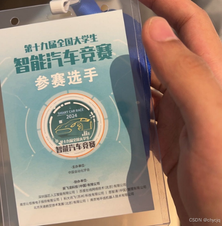

# 全国大学生智能汽车竞赛 镜头组入门（摄像头元素教程）

> **原文**：[https://blog.csdn.net/chq66666/article/details/142334183](https://blog.csdn.net/chq66666/article/details/142334183)
> **作者**：chq66666（原创）
> **发布时间**：2024-10-27 11:56:29　|　**最后修改**：2026-01-20 09:11:40
> **数据**：阅读 1.6k　|　收藏 39　|　点赞 13
> **抓取保存**：2026-11-15 07:27　|　配图本地目录 `assets/csdn_142334183/`（1/1 张已下载）

---

作为一个电子信息系的学生，智能车竞赛算是专业对口的，含金量挺高的赛事。

我们从23年12月的蹒跚起步，到十九届区赛低速完赛，一路上的曲曲折折，成长之路充满了挑战。想写一篇博客，分享一下我们的学习，进步的过程，给当时的我们，或者新参赛的学弟学妹们一些参考。

智能车不同于电赛。电赛需要在四天三夜的紧张赛程中持续输出成果，而智能车竞赛则是长达半年的探索过程。在这半年里，你需要边学习边实践，不断尝试各种解决方案，投入大量时间进行试错。这种持续性的成长体验，是其他竞赛难以企及的。

智能车比赛绝非简单的"水赛"，其工程量之大令人咋舌。相信各位读者所在的院校也缺乏成熟的"祖传代码"作为参考，一切都需要从零开始构建。最终嵌入我们赛车的核心逻辑代码约2000行，而这背后被推翻重写的代码更是数不胜数。大家要做好长期奋战、通宵调车的心理准备。

不过现在笔者已经实习了，大学生涯即将结束。回过头来看23年末到24年中与车接触的这半年时间里，感觉这是我大学生活中最珍贵，最想回到的半年。在这半年里，秋末到盛夏，从实验室前方用A4纸铺的空地到搬到了属于自己的教室，从学长留下的没有任何资料的三轮车，到我们自己选择自己的车模，我们几个因为同样热爱而聚在一起的人，开始了近乎痴迷的探索。可以心无旁骛的探索，肆意的发挥自己的编程能力，没有任何的追功逐利，这是一种肆意的、充满创造快乐的编程。没有KPI的压迫，没有功利性的追逐，代码的每一处优化，都直接转化为小车更流畅的过弯、更果断的决策。那种“亲手创造”并即刻看到物理世界回馈的成就感，是任何虚拟成绩都无法比拟的。

如今，当我坐在写字楼里，面对不同的任务与节奏，越发怀念那半年的“痴迷”。那是一段被梦想点亮的、浓度极高的青春。它不仅仅是一场比赛，更是一次关于专注、创造与友情的深度修行。车轮碾过的，不仅是赛道，更是我们共同成长的轨迹。那辆智能车，最终驶向了比赛的终点，也载着我们，驶向了更好的自己，和一段永不褪色的金色年华。

此外，智能车的控制思路提升的是你的编程层次。完成这么一项庞大的任务后，学到的经验可以平移到其他比赛上，比如电赛控制类。

**正式开始：**

首先是要确定参赛人员的问题，智能车整体的任务比较庞大，尽量不要有摸鱼的队员，我们组是从零开始，学校没有摄像头部分的传承，之前参加的组别用的是纯电磁巡线，摄像头又是比赛的下限，所以我们组别的分工是一个搞硬件，一个写车的驱动，另一个写摄像头部分的代码。

硬件是一个容易让人忽视的部分，却又十分重要。我们的硬件基本上是比赛前四五天才请学校另一组（电磁）的学长把无刷电调画完，实际上给我们调带负压的时间只有短短的3~4天（我们在无负压的情况下调了很久，因为不确定之后能不能用上负压，于是决定保下限）

我主要负责的是摄像头的部分，任务主要是是寻赛道边线，然后进行元素识别和补线，然后给出中线数组，给调参的同学

调参的同学根据我给出的中线数组，确定舵机的角度，车的速度，搏上限。

我们组也没用很高的成绩，所以这些教程只是我个人的一些想法，新入门的同学可以看看，佬们直接跳过就可以了

[智能车镜头组入门（一）车模的选择-CSDN博客](https://blog.csdn.net/chq66666/article/details/142342965?sharetype=blogdetail&sharerId=142342965&sharerefer=PC&sharesource=chq66666&sharefrom=mp_from_link "智能车镜头组入门（一）车模的选择-CSDN博客")

[智能车镜头组入门（二）电路硬件的设计-CSDN博客](https://blog.csdn.net/chq66666/article/details/142343687?utm_medium=notify.im.blog_audit.20240918.a&username=chq66666 "智能车镜头组入门（二）电路硬件的设计-CSDN博客")

[智能车镜头组入门（三）巡线-CSDN博客](https://blog.csdn.net/chq66666/article/details/142344270?sharetype=blogdetail&sharerId=142344270&sharerefer=PC&sharesource=chq66666&sharefrom=mp_from_link "智能车镜头组入门（三）巡线-CSDN博客")

[智能车镜头组入门（四）元素识别-CSDN博客](https://blog.csdn.net/chq66666/article/details/142364610?sharetype=blogdetail&sharerId=142364610&sharerefer=PC&sharesource=chq66666&sharefrom=mp_from_link "智能车镜头组入门（四）元素识别-CSDN博客")

[智能车镜头组入门（五）元素补线-CSDN博客](https://blog.csdn.net/chq66666/article/details/142379915?sharetype=blogdetail&sharerId=142379915&sharerefer=PC&sharesource=chq66666&sharefrom=mp_from_link "智能车镜头组入门（五）元素补线-CSDN博客")

接下去会逐步更新车模的控制（pid/后轮差速/编码器值和实际速度，调参的目的），大家有什么疑问也可以私信我

---

## 附：配图原始地址

1. https://i-blog.csdnimg.cn/direct/e6801a90778c4aeeafffc0aed2e96081.png

> 本文为原文正文的完整转录（含代码块与配图），文字与代码未做改写；仅补了上述元信息、本地图片路径，并把并排图片拆成独立行以便阅读。
