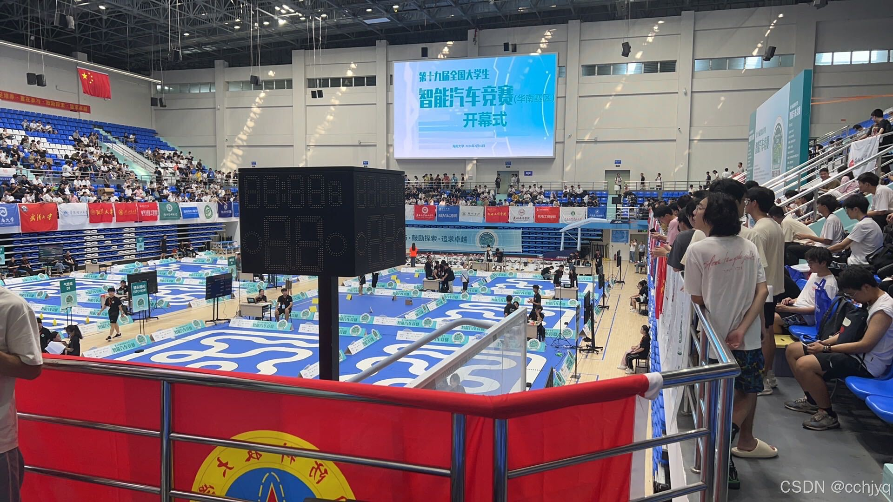
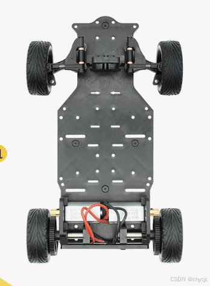
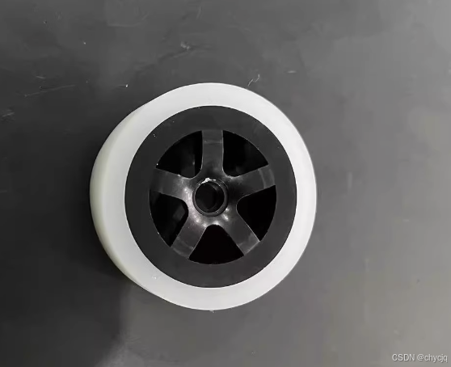

# 智能车镜头组入门（一）车模的选择

> **原文**：[https://blog.csdn.net/chq66666/article/details/142342965](https://blog.csdn.net/chq66666/article/details/142342965)
> **作者**：chq66666（原创）
> **发布时间**：2024-09-18 20:54:33　|　**最后修改**：2026-01-20 09:20:17
> **数据**：阅读 1.9k　|　收藏 20　|　点赞 4
> **抓取保存**：2026-11-15 07:27　|　配图本地目录 `assets/csdn_142342965/`（3/3 张已下载）

---

这篇文章，我会简单的介绍下车模的、轮胎和负压的选择

今年的镜头组是自制车模，这比较考验学校之前参赛的经验。我们选择了某飞的mini车模。提供智能车方案的无非就两家，某飞和某邱，我们学校之前都用的是某飞的，在某飞给出的演示视频里，mini车模能比较顺畅的通过避障，所以我们选择了某飞的mini车模。

四轮和三轮相比，控制更加简单些，三轮的转向和速度是在两个动力轮上的，四轮的后轮只要负责大力推和差速，控制会简单不少，也更稳定，不容易漂移，所以肯定是选择四轮车模

也有的学校选择的是c车模，然后改了c车模的底板，把他轴距缩短。车的转弯半径和车的轴距有关，轴距越短，车的转弯半径就越小。

我们在华南赛区看到的大部分的学校，都用的是c车模，很少有用mini车模的，之后我会简单的介绍下原因

**关于轮胎**

轮胎的选择主要有三种：普通胎，硅胶胎，光头胎。

普通胎是车模自带的那个黑色的胎，在高速的情况下容易打滑。

我们选择了硅胶胎，tb上大概50一个

光头胎是普通的轮胎，磨去了上面的花纹，小黄鱼上有现有的卖，也可以自己买软化剂自己磨，网上也有相关的教程。

今年的规则是轮胎不能有粘性物质，在比赛的时候，裁判会把你的车放在一张纸上，如果把车拿起来，纸不会动的话，那么你的车轮才是合格的。

因为今年我们用的是新的硅胶胎，所以刚开始的时候粘起来了一点点，后来两次没粘起来，裁判也放我们进去了。

以我们的经验是 光头胎>硅胶胎>原胎，在没有灰尘的情况下。如果有灰的话拿透明胶粘一下就行了，比赛的时候要咨询下裁判的意见。

前面我有提到，更多学校选择选择c车模的原因是 c车模的轮距比较宽，重心比较稳，在高速弯的时候不容易翻车。我们的过弯速度不是很快。之前我们试过前后轮都用硅胶胎的时候，过90度直角弯的时候会直接翻车，之后我们把后轮换成了车模原来的胎，允许一定量的漂移，通过开高负压来抑制，是没有办法的办法。

此外还要说明的一点是，轮胎和轮轱辘之间必须要封胶，用704胶就可以了，效果挺好，就是要拆下来的时候比较麻烦。

**关于负压**

负压部分我们用的是逐飞的方案，也就是吊扇，也有其他学校用的涵道风扇，涵道风扇需要另外的底板，可以去小黄鱼上买，两者各有千秋，可以根据自己车模的实际情况选择。

---

## 附：配图原始地址

1. https://i-blog.csdnimg.cn/direct/a0df042014fc4cc196995bc3f4d1ad44.jpeg
2. https://i-blog.csdnimg.cn/direct/4c486747f8e945baa68d9836a514bbc5.png
3. https://i-blog.csdnimg.cn/direct/926ecf300aa84a80b664b032b7f4245c.png

> 本文为原文正文的完整转录（含代码块与配图），文字与代码未做改写；仅补了上述元信息、本地图片路径，并把并排图片拆成独立行以便阅读。
