# 智能车镜头组入门（三）巡线

> **原文**：[https://blog.csdn.net/chq66666/article/details/142344270](https://blog.csdn.net/chq66666/article/details/142344270)
> **作者**：chq66666（原创）
> **发布时间**：2024-09-18 22:00:36　|　**最后修改**：2026-01-23 14:29:30
> **数据**：阅读 9.5k　|　收藏 245　|　点赞 83
> **抓取保存**：2026-11-15 07:24　|　配图本地目录 `assets/csdn_142344270/`（11/11 张已下载）

---

镜头组的特点是通过摄像头来获取赛道的信息，从而达到获取误差的目的，，完成转向和速度决策。而镜头组带前瞻的效果，所以图像可以帮助我们进行速度决策，这也是镜头组速度相较于其他组别较快，观赏性较强的原因。

摄像头基本上就某飞和某邱的，我们选择的是某飞的总钻风。

**关于帧率：**我们的方案，带上元素识别，大概在TC264上5ms一帧，所以我们开了100hz的图象。

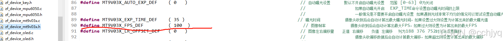

之前我看别的博客上有人说，他们组的50帧到100帧提升不大，但是我试了下100帧还是有明显的提升的，大家可以都试试

摄像头部分的主要参数是图象大小，帧率，曝光度，摄像头高度角度，和摄像头是否居中

图像大小的话，我们使用的是某飞默认的188\*120。帧率的话随着图像处理的时间来算，我们的方法是开一个优先级高的1us定时器，然后使用一个long long int记录每帧的时间（int最大65535，也就是说时间超过了60ms计时器会溢出，正常运行的时候很少有大于60ms的，但是如果调试的时候用了printf等会大幅降低速率，溢出可能会导致程序卡死）

**曝光度**需要根据你的参数调节，我们的曝光度属于比较暗的那种， 赛道外的蓝布在图像上已经接近黑色。

我们的**前瞻**基本上为3m多 摄像头高度为33cm 19届不限制摄像头高度。摄像头仰角过大的话，会造成近点丢线。而前舵机的打角基本上之依赖于前40/50CM内的误差。直道前的误差基本上只是用于速度决策。所以要根据自己的参数调整前瞻长度。

在摄像头角度确定后，就不要再去动摄像头了，在调整正中后，用大量热熔胶把摄像头固定死。

调整正中的方法：在赛道中间黏一条黑色胶带，然后摄像头在图像上 用软件画一条黑线 然后把车放在赛道中央，让黑色胶带从车中间竖直穿过，然后转动摄像头 使摄像头上的软件中线与赛道上贴的黑胶带重合。

**其他一些小的建议**

建议大家购买某飞的wifi图传模块，这样在上位机上可以实时看到小车获取到的图像，图传的帧率比屏幕高，也可以保存视频观察补线的问题。

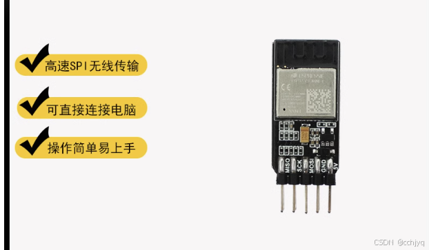

没有打广告的意思，真的很好用。这个需要5v供电，使用的时候需要打开主板上的电源使用，不能依靠下载线供电！！！！

**关于搜线**

**搜线**方面我们采用的是某飞的方案，核心是差比和算法。具体实现来说即先通过近端白线的平均值来获取认为的白块，然后通过这个白块来寻找最长上升白列，然后通过这个白列向左向右的寻找边线，之后我会详细介绍

**是否二值化?**

图象识别有一个比较大的差别就是是否二值化，就是把灰度图转换成只有黑白的图，一般常用的额算法是大津法，我们最开始也是用的这个方法，后来尝试了一段时间一段时间之后，觉得二值化的话时间实在太长了（印象中单二值化的时间是>15ms的），就放弃了二值化的方案。

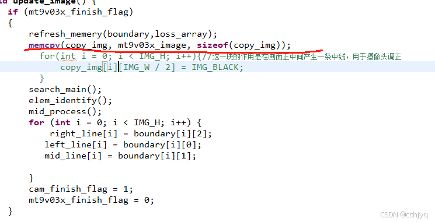

如果画面撕裂，我们认为可能是摄像头采用dma传输数据的原因，把图象复制出来一份后，没有了撕裂的问题。而且memcpy这个函数和数组直接赋值的方式是不同的。 memcpy非常快，时间基本可以忽略不计。

从这句话也可以看出，逐飞的库摄像头的信息放在 mt9v03x\_image[MT9V03X\_W ][MT9V03X\_H ]这个数组中的，当运行摄像头初始化mt9v03x\_init()后就可以直接调用这个数组来使用图像了。

如果你购买了逐飞的wifi图传，需要打开板载的5v电源，修改zf\_device\_wifi\_spi.h内的宏定义（wifi账密、上位机的ip地址）打开逐飞助手，才能使用。

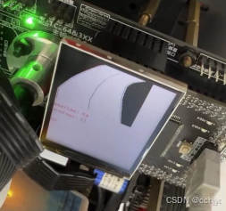

**另外需要说明一点的是**，屏幕刷新的过程会阻塞单片机cpu的运行，需要将这些不影响小车运行的东西（比如屏幕，串口调参）这类程序放在主函数中，其他的放在中断中运行。

程序结构主要是快中断（1ms）跑后轮pid，慢中断（10ms）跑图像中断。图像的中断跑在core1里（core1是三层流水线，速率比core0快些）。然后双核心core0跑串口的发送，core1跑屏幕的刷新和按键调参。注意：需要考虑**临界区保护的**问题，即两个核心不能同时写一个外设。

我来简单的介绍下我们采用的方案，也就是逐飞的方案，具体可以去看他们b站上的视频。

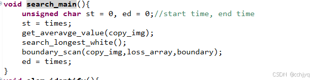

我们将搜线和元素识别分开来写，封装成了两个大的函数

这是我们用来搜线的函数，搜线的只要快和稳就行了，顶端有部分丢线其实也是可以接受的（比如20行之前的，这个位置的实际距离往往在1.5m往上，不记在误差范围内）

我们用了两个变量和一个定时器来获取搜线所用的时间，便于改进，在某些大直道的情况下，因为使用了边线继承的方法，车辆稳定不动的情况下能做到800ns一帧

**我们的搜线**

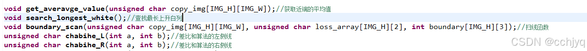

主要用到的函数就是这几个

**get\_average\_value();**

首先是求图象近端的平均值，也就是这一块下面红色区域的平均值，然后用吧这个平均值用于

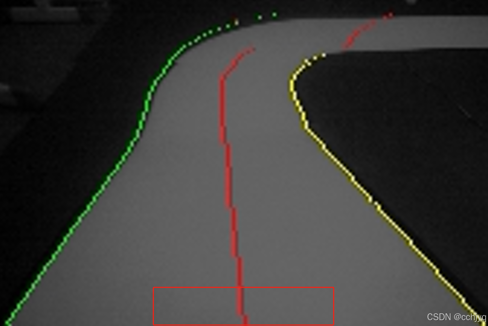

白线和出界的判断，比如平均值是小于50 那么说明车跑出界了（这个50的值会根据光线的变化而变的，换场地需要更改曝光值），需要设置一个信号量给调参的同学，让小车停下来。（这个边线不贴合赛道可能是无线图传的问题）

```cpp
    int sum = 0;
    for (int i = 0; i < 10; i++) {
        for (int j = 0; j < 3; j++) {
            sum += copy_img[IMG_H - 1 - j][IMG_W / 2 - 5 + i];
        }
    }
    average_value = sum / 30;
    absolute_white = average_value * DESIRE_WHITE;
    absolute_black = average_value * DESIRE_BLACK;
```

此外还有两个变量，absolute\_white 和absolute\_black，这两个变量是认为的绝对白色和绝对黑色，在搜线中可以加快速度。

**search\_longest\_white();**

现在我们有了这个的白列值，我们可以用这个白列值来寻找最长上升白列，就是如图所示的黄线

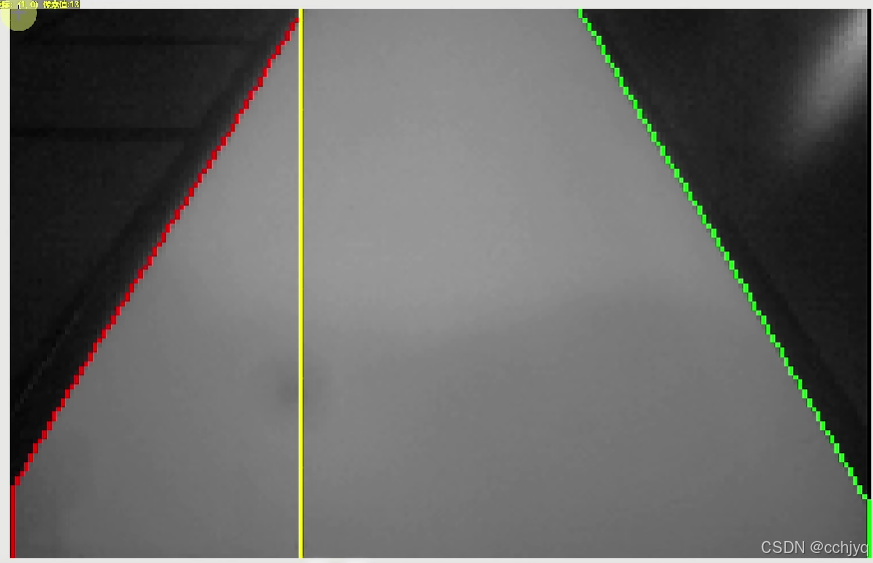

（这是逐飞的图象，所示的黄线就是最长上升白列）

```cpp
for (int i = 0; i < IMG_W - 1; i += 3) {
          if(i > last_find - 5  && i < last_find + 5) continue;
          length = 0;
          for (int j = IMG_H - 1; j >= 0; j--) {
              if (copy_img[j][i] > average_value || abs(copy_img[j][i] - average_value) < FIND_LINE_LENGTH) {
                  length++;
              }
              else {
                  break;
              }
          }
          if (length > max_length) {
              if (max_length > IMG_H - HEAD_LENGTH) {
                  max_length = length;
                  max_line = i;
                  break;
              }
              max_length = length;
              max_line = i;
          }

      }
```

最长上升白列这个算法之后，会得到max\_line 和max\_length这两个参数，max\_line说明的是最长上升白列出现在第几行，max\_length说明最长上升白列的长度。

**boundary\_scan();**

先介绍下逐飞的差比和算法，也叫对比度搜线

例如我的图象是188\*120的图象，则往竖直方向，找到一个最长的白列，或是大于某一个数值的长白列（就是如图所示的黄色的线），以这个线为依据开始向左扫左线，向右扫右线之后要做的就是边线的扫描，其他学校有用八领域法的，算法难度比较高。我们用的也是逐飞的差比和算法，比如说 ，目前找到的点是（40，100）灰度值为a，我们要搜寻左边线，就是要搜索和这个点的左边隔了一段距离，如（35,100）这个点，灰度值为b，通过这个（a - b）/(a +b) 所得的值 大于某一个阈值的时候，则说明了这个是一个明显的黑白交接点，可以把它认为是赛道的边线。

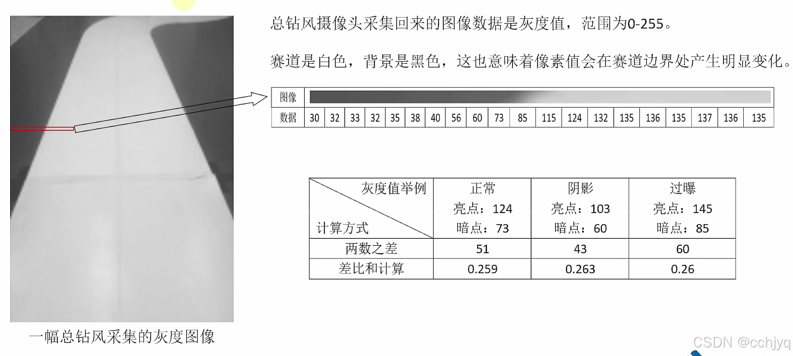

```cpp
unsigned char chabihe_L(int a, int b) {
    float result = 0;
    if(abs(a - b) <10) return 0;
    cbhnum_L ++;
    result = (a - b) * 1000 / (a + b);
    if (result > CHABIHE_THRESHOLD * 1000 ) {
        return 1;
    }
    else return 0;
}
```

我们统计了各点通过差比和算法来找到边线的方式，就是上面所看到的cbhnum\_L ++，差比和算法和上面提到的continue break的方法相比，速度固然慢了很多。所以要尽可能的找到方法少用差比和。

有些优化的方案，比如每继承每一次的值，如果上一条边找到了左边线，那就往右回撤几个像素 再继续进行差比和运算，可以大大减少运算量（其实前面说到的寻找最长上升白列的算法也可以采用集成的方法，因为每一帧图象间隔的时间非常近，每一帧的是相近的）。

第一次搜线是继承了上一条线的往回BACK\_LENGTH个像素，搜到了设一个标志位，如果没搜到或者是上一条线也没搜到，则重新开始。

需要对继承的搜线进行一些限制，不然会有一些意想不到的情况，我给出的我们的代码是做过一些限制的，大家如果没看懂可以试着自己先写写，遇到问题了再来看看我们的思路

```cpp
if (find_flag_L == 1 && (boundary[i + 1][LEFT]  > BACK_LENGTH)){
            find_flag_L = 0;
            for(j = last_update_L + BACK_LENGTH; j >= last_update_L  - BACK_LENGTH; j--){//这里是回退了5格，搜左边线，也就是向右走了5格，然后才开始搜索
                if(copy_img[i][j] > absolute_white) continue;
                if(copy_img[i][j] < absolute_black && chabihe_L(copy_img[i][j + CHABIHE_LENGTH], copy_img[i][j])) {
                    boundary[i][LEFT] = j;
                    find_flag_L = 1;
                    last_update_L = j;
                    break;
                }
                if (chabihe_L(copy_img[i][j + CHABIHE_LENGTH], copy_img[i][j])) {
                    boundary[i][LEFT] = j;
                    find_flag_L = 1;
                    last_update_L = j;
                    break;
                }
            }
        }
        else {//这里是没搜到的情况，就从最长上升白列开始搜索
            for(j = max_line; j > 0; j--){
                if(copy_img[i][j] > absolute_white) continue;
                if(copy_img[i][j] < absolute_black && chabihe_L(copy_img[i][j + CHABIHE_LENGTH], copy_img[i][j])) {
                    boundary[i][LEFT] = j;
                    find_flag_L = 1;
                    last_update_L = j;
                    break;
                }
                if (chabihe_L(copy_img[i][j + CHABIHE_LENGTH], copy_img[i][j])) {
                    boundary[i][LEFT] = j;
                    find_flag_L = 1;
                    last_update_L = j;
                    break;
                }
            }
        }
```

这样我们就基本完成了搜线，接下去一个更重要的部分是元素识别和补线。搜线中还可以获取一些额外的信息用于元素识别。

从边线中我们还可以获取到两个信息。一个是左右边线的丢线，和连续丢线的长度。另一个是如果小车在一条大直道的情况下，假设最顶端宽度是25，最低端宽度是150，这样我们就可以估计一个正常赛道的宽度。然后我们计算扫线扫到的赛道宽度，如果这个宽度和理论赛道宽度差距比较大的话，那就有是元素的嫌疑了

摄像头比较重要的一点是 确定好图象的大小尺寸，摄像头的高度和角度，之后就不要在变化了，确定好前瞻距离和最近距离。近端距离是来控制转向的，前瞻距离是做速度决策的

如果突然卡死了，或是时间出乎意料地长， 大概率是数组越界了，检查下数组的索引

最后分享一下调试方法。因为给英飞凌下载比较慢，而且往往刚开始需要大规模的改写你的代码，需要频繁的下载，比较耗时间网上看到有些大佬通过c#写了上位机，这样就可以直接在电脑上写代码了。我们用的是最原始的办法

我们用串口传出了一张图片的灰度值，然后把他保存到一个文件里，用这个数组给copy\_img赋值

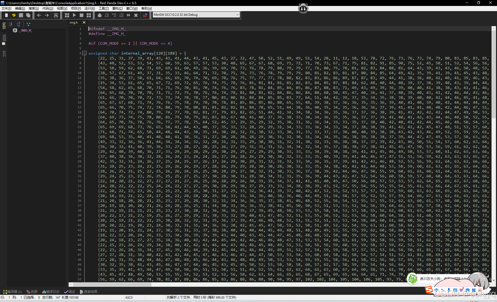

通过这个函数，把边线数组打印出来，这样调试就方便多了，美中不足的是不能测花费的时间（时间复杂度）

```
void print() {
    for (int i = 0; i < 120; i++) {
        printf("%-3d ", i);
        for (int j = 0; j < 188; j++) {
            if (boundary[i][LEFT] == j) {
                printf("*");
            }
            else if (boundary[i][MID] == j) {
                printf("_");
            }
            else if (boundary[i][RIGHT] == j) {
                printf("#");
            }
            else {
                printf(" ");
            }

        }
        printf("\n");
    }

}
```

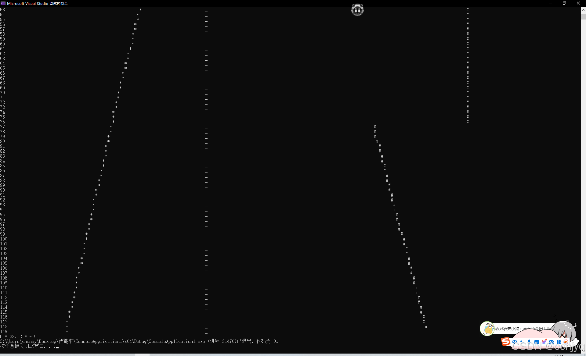

这个vs2022下调试的开源了，不过不是我们的最终代码，大家试验的时候可以玩玩试试

[https://gitee.com/chenhy2357/smart\_car\_cam](https://gitee.com/chenhy2357/smart_car_cam "https://gitee.com/chenhy2357/smart_car_cam")

后续文章可以参考[https://blog.csdn.net/chq66666/article/details/142364610](https://blog.csdn.net/chq66666/article/details/142364610 "https://blog.csdn.net/chq66666/article/details/142364610")(元素识别)

[https://blog.csdn.net/chq66666/article/details/142379915](https://blog.csdn.net/chq66666/article/details/142379915 "https://blog.csdn.net/chq66666/article/details/142379915")（元素补线）

---

## 附：配图原始地址

1. https://i-blog.csdnimg.cn/direct/e903f8b4277f4429b25dc6e89d935c41.png
2. https://i-blog.csdnimg.cn/direct/3217aebf809040c3b21d396009ff98ca.png
3. https://i-blog.csdnimg.cn/direct/3650ce3cd6984c20b7a0b2babf69c258.png
4. https://i-blog.csdnimg.cn/direct/1287bb038663469089a1387f45f1f515.png
5. https://i-blog.csdnimg.cn/direct/d79981975ab54be6a0abe4897b307c0e.png
6. https://i-blog.csdnimg.cn/direct/5edbd0f26b3a4e8d83e77b8155b557c4.png
7. https://i-blog.csdnimg.cn/direct/c9316ef9246a4f6db697588b05b4efad.png
8. https://i-blog.csdnimg.cn/direct/7c6b932b80a64b6c8d9336de09f92b4a.png
9. https://i-blog.csdnimg.cn/direct/fd3c2ef8aba94c1d8ba39a75ee73a36e.png
10. https://i-blog.csdnimg.cn/direct/6982c7bbe1e14db4ac8cfdfb9d1a330b.png
11. https://i-blog.csdnimg.cn/direct/02703ec3b0dc45928d2d234c5b7fe0a0.png

> 本文为原文正文的完整转录（含代码块与配图），文字与代码未做改写；仅补了上述元信息、本地图片路径，并把并排图片拆成独立行以便阅读。
