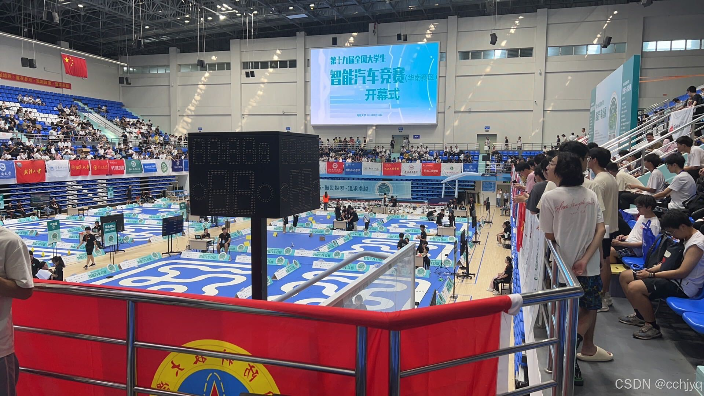
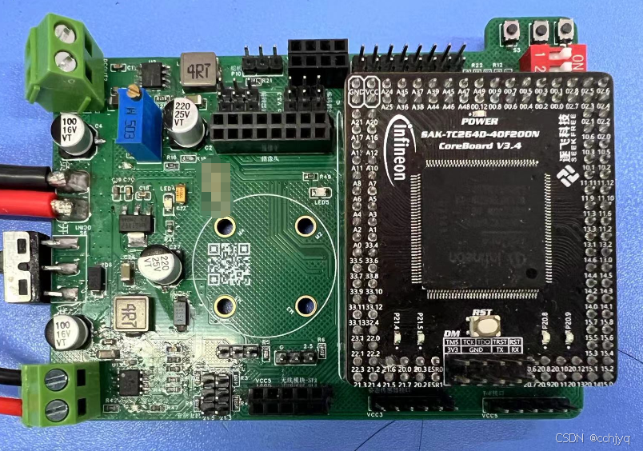
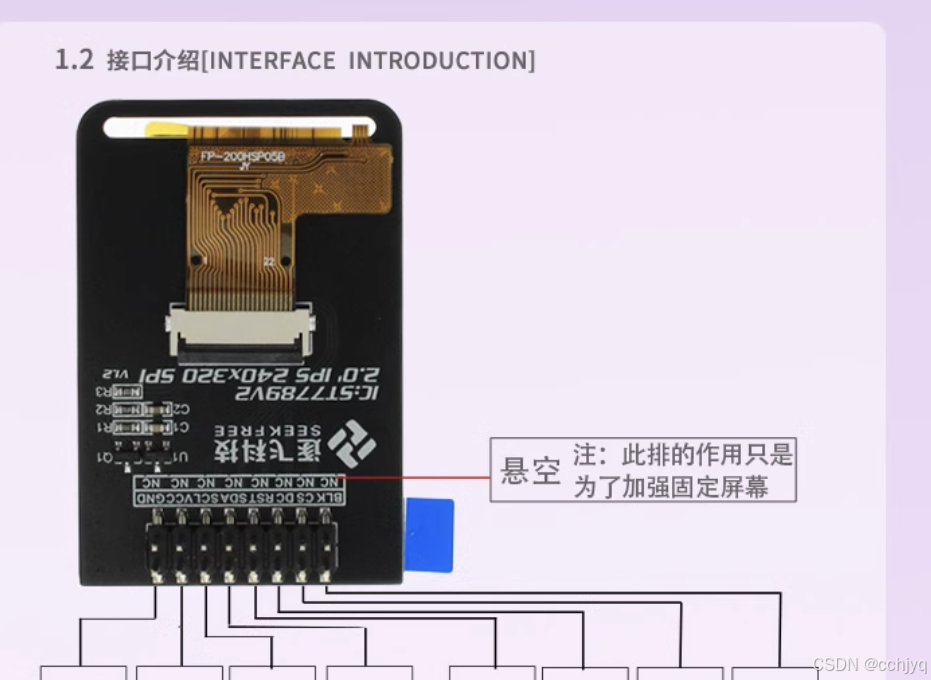

# 智能车镜头组入门（二）电路硬件的设计

> **原文**：[https://blog.csdn.net/chq66666/article/details/142343687](https://blog.csdn.net/chq66666/article/details/142343687)
> **作者**：chq66666（原创）
> **发布时间**：2026-10-25 09:39:18
> **数据**：阅读 1.7k　|　收藏 15　|　点赞 10
> **抓取保存**：2026-11-15 07:28　|　配图本地目录 `assets/csdn_142343687/`（3/3 张已下载）

---

自己设计的板子是参赛的必备条件，硬件在前期的投入比较高，后期基本上没问题。我们组就在硬件上吃了些亏。

负压镜头组需要四块板，一个电机驱动板，一个主板，另一个是无刷电调。

前文也说过，我们用的是mini车模，我们把主板设计在了车的中心的摄像头支架上，这意味着主板的设计大小很有限，我们参加的是英飞凌组别，逐飞给的tc264的最小系统板又比较大，这就造成了我们的主板 摄像头支架在中间，然后核心板紧贴着摄像头支架。

摄像头部分需要单独供电，不能和整机的3.3v用同一个供电，如果用了同一个3.3v 摄像头会花。

此外，摄像头拍线不要频繁的去拆，很脆，有时候摄像头画面撕裂是因为拍线不行，如果重启机器还是不行的话那就换根排线。

之前我们为了两边的负压大小平衡些，特意要对称的主板设计，长度来到了12cm，不能用嘉立创的免费打样。但是画硬件的同学不太给力，三板都有些小问题。一个四层板大概需要220块，我们浪费了近700块。后来我们放弃了对称的想法，用了10\*10之内的板，在7月初才画完出来了最后能用的板。

此外，注意板子上的丝印，因为画板子和安装的同学不一定是同一个，我们就是因为电驱和主板之间的连线没有写正负极的丝印，炸了一次板子，犯了低级错误。

芯片不要买太便宜的，有可能有质量问题，我们的芯片是在you信上买的，质量还可以

还有一点就是，屏幕尽量选择串口屏（spi的那个），因为串口屏只有一拍排针，降低了布线的难度

好的硬件的评判标准是好用和稳定，在硬件上并不需要做过于激进的创新，某飞也给出了各部分的原理图。

硬件的需要在顶层和顶层阻焊层上加上自己的队名，需要在铜层上写明，不能只写丝印。

---

## 附：配图原始地址

1. https://i-blog.csdnimg.cn/direct/fd0ef7479d5d4fdea7abaaea55f23580.jpeg
2. https://i-blog.csdnimg.cn/direct/da8fe744f1ec4f228f73bf7294f41d6f.png
3. https://i-blog.csdnimg.cn/direct/77f0cff7a7b3445f88f2334c04b1590f.png

> 本文为原文正文的完整转录（含代码块与配图），文字与代码未做改写；仅补了上述元信息、本地图片路径，并把并排图片拆成独立行以便阅读。
