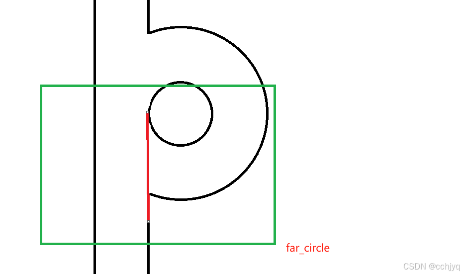
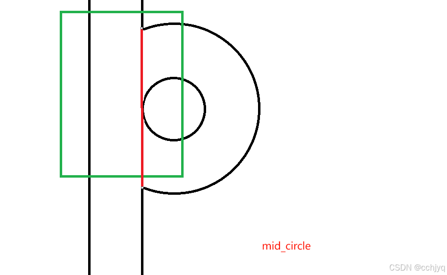
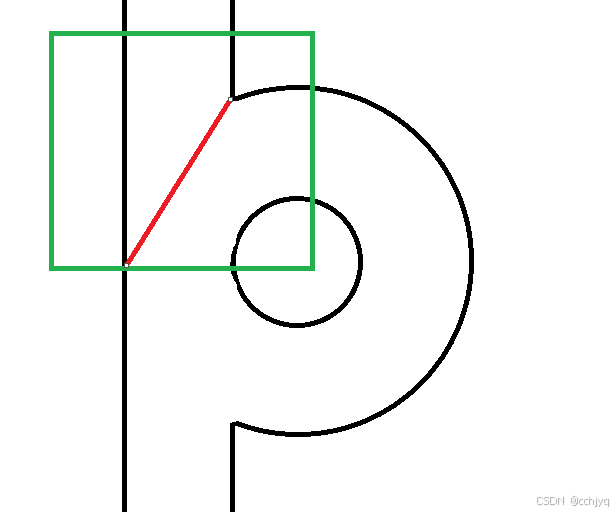
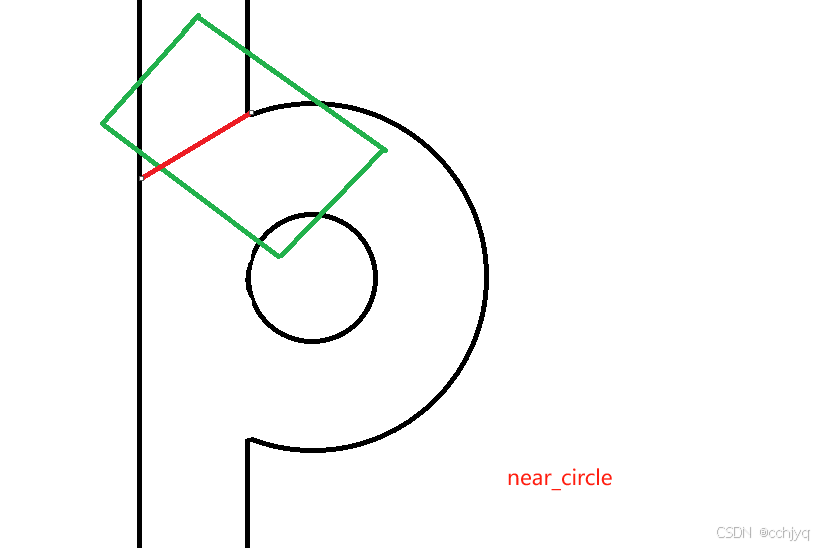
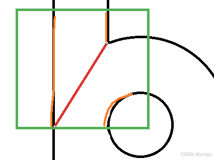
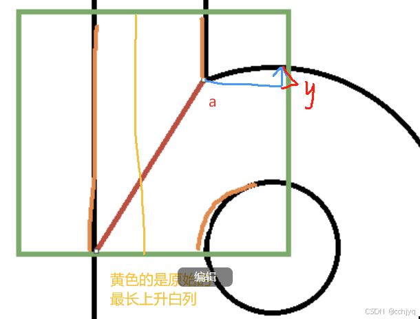
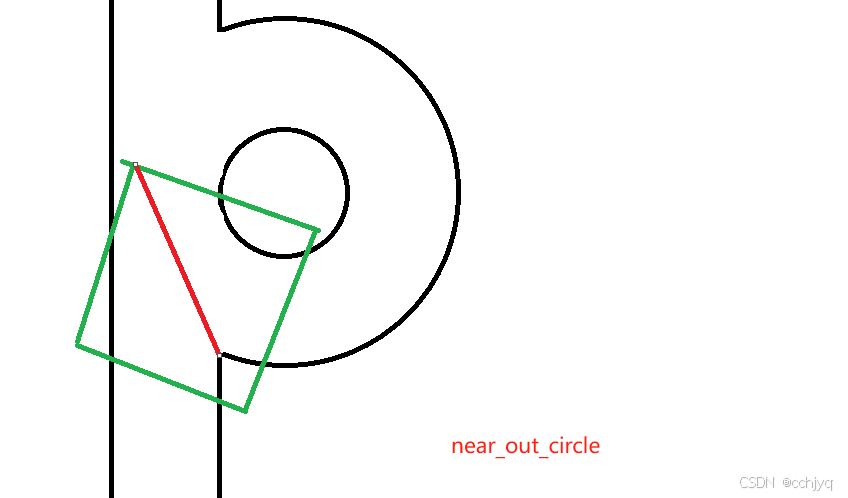
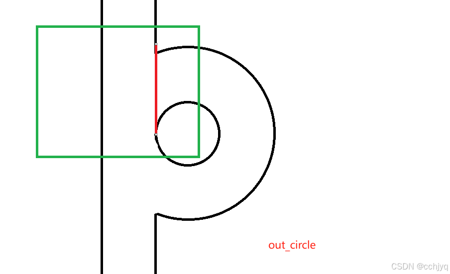
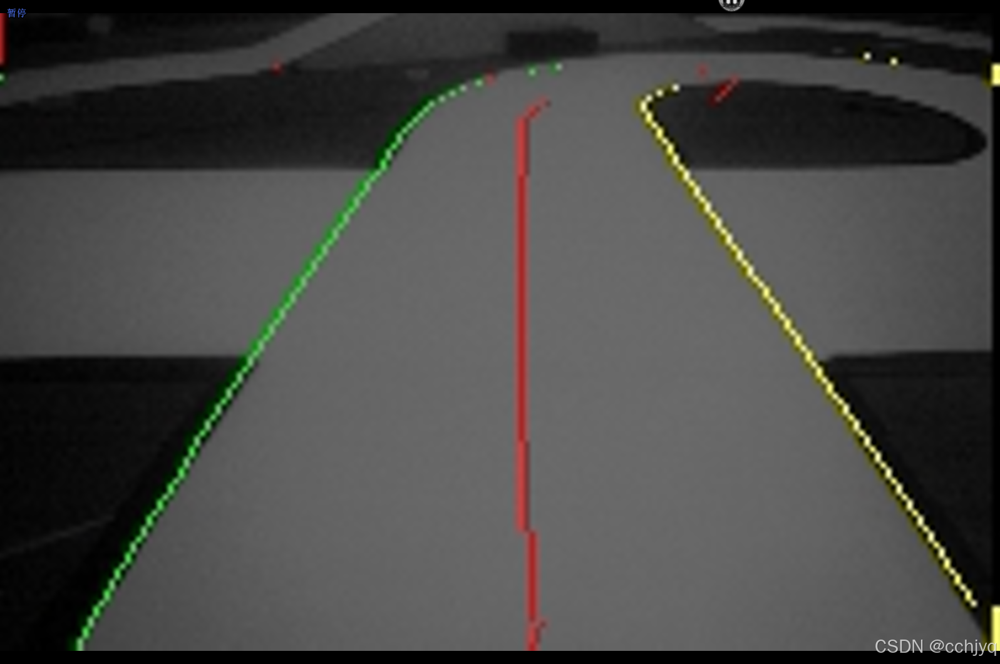
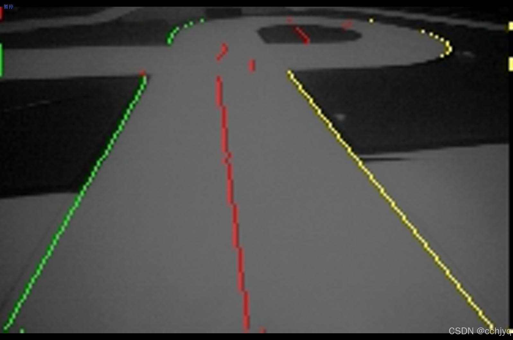

# 智能车镜头组入门（五）元素补线

> **原文**：[https://blog.csdn.net/chq66666/article/details/142379915](https://blog.csdn.net/chq66666/article/details/142379915)
> **作者**：chq66666（原创）
> **发布时间**：2024-09-20 11:30:07　|　**最后修改**：2026-01-20 09:14:35
> **数据**：阅读 3.1k　|　收藏 126　|　点赞 20
> **抓取保存**：2026-11-15 07:26　|　配图本地目录 `assets/csdn_142379915/`（10/10 张已下载）

---

元素补线是一件非常麻烦的事情，特别是圆环的补线，需要区分多个状态机

```
    FAR_CIRCLE_L,    // 即将到达圆环
    MID_CIRCLE_L,    // 圆环 检测到两个断点 并且右下角没有丢线
    NEAR_CIRCLE_L,
    IN_CIRCLE_L,     // 圆环中
    NEAR_OUT_CIRCLE_L,
    OUT_CIRCLE_L,
```

我们用一个枚举变量来表示这个状态机。我们可以通过我前一篇文章的方法识别到圆环。

在详细开始之前，我先说明下要用到的工具函数

```cpp
void two_point_fix_line(int p1_x, int p1_y, int p2_x, int p2_y, line_type line, unsigned int change_flag);//通过两点来补线
void two_point_fix_arc_line(int p1_x, int p1_y, int p2_x, int p2_y, line_type line, unsigned int change_flag);//通过两点来补线，椭圆曲线的方式
void predict_fix_line(int source, int end, int length, line_type line, unsigned int change_flag);//通过一个点，和相距length长度的那个点，连线，并且预测长度
void two_point_predict_fix_line(unsigned char p1_x, unsigned char p1_y, unsigned char p2_x, unsigned char p2_y, line_type line, unsigned char change_flag) ;//两点 连线 补线
unsigned char is_straight(unsigned char begin, unsigned char end, line_type line);//直线判断函数
unsigned char get_line_num(line_type line, unsigned char begin, unsigned char end, char way);// 获取line 最靠近way的那边线的坐标，比如说对圆环使用这个函数，获取到的是圆环环心做靠近右边（直线）上的一点
```

两点补线，两点补弧线（椭圆曲线的方式），两点连线后，往其中一个方向预测补线（补射线），还有一个get\_line\_num()之后在进行讲解

两点补线，在小车还没进入十字的时候可以使用，

两点补弧线，这个需要大家选择性使用，我们之前用于进圆环的补线，后来发现效果和直接直线差不多

两点预测补线，是小车进入十字之后的拉线可以使用

具体有些图片，我们去年弄的时候也没用保存图片，可能要今年学弟学妹们再做车的时候才能补上了。

我们将圆环的状态分为这几类



这个是远离圆环，也就是刚刚开始检测到圆环的时候需要使用这种补线方式

主要是先进入状态机，然后找点，再连线

```cpp
    if (mode == FAR_CIRCLE_R) {
        unsigned char dp,up;//down point up point
        for(int k = 0; k <= loss_pointer_R; k += 2){
            if(loss_counter_R[k / 2] > 20 && loss_pointer_R > 2){
                dp = loss_array_R[k] + 5;
                for(int j = k; j <= loss_pointer_R; j += 2){
                    if(abs(loss_array_R[k + 2] - loss_array_R[k + 1]) < 5) continue;
                    up = get_line_num(RIGHT, loss_array_R[k + 1], loss_array_R[k + 2], 'L');

                }
                two_point_fix_line(boundary[dp][RIGHT], dp, boundary[up][RIGHT], up, RIGHT, 1);
                return;
            }
        }
    }
```



然后第二个是中圆环，就是小车在圆环中间，这里需要补两根线（其实这部分不补线也是可以的，只是小车会摆动）

```cpp
    if (mode == MID_CIRCLE_R) {
        int tp = 0, mp = 0; // top point, mid point
        for(int k = 0; k <= loss_pointer_R; k += 2){
            if(loss_array_R[0] == IMG_H - 1 && k == 0) continue;
            if(abs(loss_array_R[k] - loss_array_R[k - 1]) > 10){
                mp = k - 1;
                break;
            }
        }
        //找顶端的线
        for(int k = mp + 3; k <= loss_pointer_R; k += 2){
            if(loss_array_R[0] == IMG_H - 1 && k == 0) continue;
            if(abs(loss_array_R[k] - loss_array_R[k - 1]) > 5 && loss_array_R[k] < 40){
                tp = k - 1;
                break;
            }
        }
        mp = get_line_num(RIGHT, loss_array_R[mp], loss_array_R[mp + 1], 'L');
        if(tp && mp)  two_point_predict_fix_line(boundary[mp][RIGHT], mp, boundary[loss_array_R[tp]][RIGHT], loss_array_R[tp], RIGHT, 1);

    }
```





最困难的是这一步near\_circle， 这一步需要分两点来讨论，原因是 如果是第一种情况的话，最长上升白列会在主道上，这样只会搜到主道上的线，不会搜到圆环上的，就是如图所示的部分，橙色的部分是搜到的边线，这样的话需要找到补线的上点和（右上角），拉一条线，同时修改最长上升白列的值（因为最长上升白列的值等于搜线的有效长度，这个数据后面会给调参的同学作误差统计的最大值）



但是如何把这个圆环的上边线搜出来呢？我们前面说过，搜线是以最长上升白列为中心，向左右搜线，所以我们可以找到这两个点a



设这个点a的纵坐标坐标是x，然后将最长上升白列的开始计算列设为图像的最右端，开始搜索白列长度，计为y，然后在进行一次边线搜索（x到x+y部分），长度是y，这样利用二次搜线，就可以吧圆环的边线搜出来了

图示的y比较小，等小车有右转的倾向的时候y就会变得很大。

为什么不能把补线写死呢?比如从左下角补到右上角，是因为圆环有大小之分。如果吧线写死，大小圆环就不适用了。应该尽量减少写死（非自然）的边线。

```cpp
    if (mode == NEAR_CIRCLE_R) {
        int point = 0;
        if(max_line < IMG_W * 3 / 4){
            for(int j = 0; j <= loss_pointer_R; j += 2){
                if(loss_counter_R[j / 2] > 10 && loss_array_R[j] < IMG_H - 10){
                    point = loss_array_R[j + 1] - 1;
                }
            }
            if(point == 0 || boundary[point][RIGHT] >= IMG_W / 4 * 3){
               for(int k = IMG_H - 1; k >= IMG_H - max_length; k--){
                   if(abs(boundary[k][RIGHT] - boundary[k - 1][RIGHT]) > 40){
                       point = k - 1;
                       break;
                   }
               }
            }
            if(point != 0){
                int research_head = get_white_posi(IMG_W - 3, point);//重新搜索的头
                if(research_head  > 10 && research_head < 90){
                    search_left_line(IMG_W - 3, point, research_head);
                    two_point_fix_line(0, IMG_H - 1, boundary[point - 3][RIGHT], point - 3, LEFT, 1);
                    max_length = IMG_H - research_head;
                }
                else
                {
                    two_point_fix_line(0, IMG_H - 1, boundary[point - 3][RIGHT], point - 3, LEFT, 1);
                    max_length = IMG_H - point;
                }
                for(int k = IMG_H - 1; k > IMG_H - max_length; k--){
                    boundary[k][RIGHT] = IMG_W - 1;
                }
            }
        }
        else{
            for(int k = 0; k <= loss_pointer_L; k += 2){
                if(loss_counter_L[k / 2] > 10){
                    two_point_fix_line(0, IMG_H - 1, boundary[loss_array_L[k + 1]][LEFT], loss_array_L[k + 1], LEFT, 1);
                }
            }
        }
    }
```

另外，由于圆环的补线（直线）是非自然的，所以在入环的出还的时候需要使用另一个权值数组，不然小车会出界（有关权值，接下来的文章会讲）



我们采用的是陀螺仪的积分来计算何时出环，也就是进入这个near\_out\_circle这个状态机。实际上出环的时候是一片雪白，只有白花花的赛道，而且我们的搜线方式没法搜水平的线，所以用陀螺仪直接拉线是一种比较简单的选择。

而且我们试过，直接拉线不容易出界。

```cpp
    if (mode == NEAR_OUT_CIRCLE_R){
        unsigned char point1 = 0;
        for(int k = 0; k <= loss_pointer_L; k += 2){
            if(loss_counter_L[k / 2] > 20){
                point1 = loss_array_L[k];
                break;
            }
        }
        if(point1 != 0){
            two_point_fix_line(IMG_W / 4 * 3, 0, boundary[point1][LEFT], point1, LEFT, 1);
        }
        else
        {
            two_point_fix_line(IMG_W / 4 * 3, 0, 0, IMG_H - 1, LEFT, 1);
        }
    }
```



最后的一个状态机，是避免重复进入环岛的。

这样，我们就完成了圆环的补线

十字补线，相对来说简单些，这是我们的图象

```cpp
    FAR_CROSS,    // 即将到达十字路口
    MID_CROSS,
```





我们分为了两个状态机，一个是远十字，另一个是十字中。远十字到十字中的判断为是否有一边完全丢线（从底下开始丢到顶）。十字中（mid\_cross）需要单独判断，是否为斜入（就是一边从底下丢线，另一边不是从底下开始丢线）。

另外附上一些调试的方法，前文说过，我们购买了某飞的wifi图传，在某些异常的情况下可以选择让车进入一个死循环（我们选用的是反复发送调试数据，就是前文说到的loss\_array\_L/R这个数组,还有其他的一些信息），然后因为同时wifi图传也会被卡死，所以你在电脑上看到的最后一帧图片就是就是误判的那一帧图。

这样有一个坏处就是小车获取到的误差值不变了，舵机打角也不会变，容易撞墙。

---

## 附：配图原始地址

1. https://i-blog.csdnimg.cn/direct/829e88fb484b4e3d99204709ebea839a.png
2. https://i-blog.csdnimg.cn/direct/4b0c472a76cc4308943a803321af7b27.png
3. https://i-blog.csdnimg.cn/direct/13119039ab9740c697b8765a84099c58.png
4. https://i-blog.csdnimg.cn/direct/c52a6a36c77e4a349f57e68d3e2ce1fd.png
5. https://i-blog.csdnimg.cn/direct/64e7fafbfb9c4fd093a8a0716fc5d017.png
6. https://i-blog.csdnimg.cn/direct/db7bc1fe089a4ee88996605692d2f437.png
7. https://i-blog.csdnimg.cn/direct/47d0faf4cfd34b3cbd335a4ffde29720.png
8. https://i-blog.csdnimg.cn/direct/6c2a442a96a740f6991871ee5d986c78.png
9. https://i-blog.csdnimg.cn/direct/ac3996b2d8a547888156fabb96f0b0a9.png
10. https://i-blog.csdnimg.cn/direct/92e76ab4241c464d80c464f305a649d6.png

> 本文为原文正文的完整转录（含代码块与配图），文字与代码未做改写；仅补了上述元信息、本地图片路径，并把并排图片拆成独立行以便阅读。
