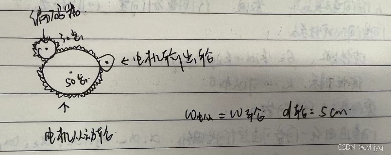
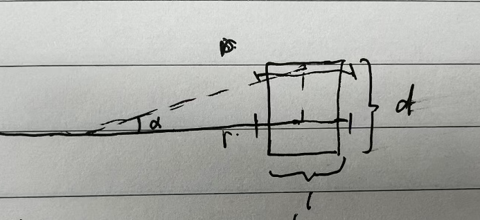
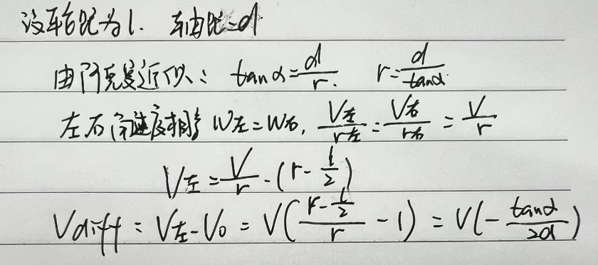

# 智能车镜头组入门（六）车模的控制

> **原文**：[https://blog.csdn.net/chq66666/article/details/142415701](https://blog.csdn.net/chq66666/article/details/142415701)
> **作者**：chq66666（原创）
> **发布时间**：2024-09-21 14:43:32　|　**最后修改**：2026-01-22 09:58:15
> **数据**：阅读 1.8k　|　收藏 31　|　点赞 7
> **抓取保存**：2026-11-15 07:28　|　配图本地目录 `assets/csdn_142415701/`（3/3 张已下载）

---

本文会简单的介绍一些车模控制的方法。前文也说到过，因为我是写摄像头部分的，所以车模的控制部分我只能给大家简单的介绍下。

大家可能有所听说，智能车竞赛又被称为调参竞赛。显然好的参数决定了小车车速的上限。

调参调的是哪呢？大家肯定会听说过PID，镜头组还有一个是权重。

**PID**

有关pid的教程，csdn上有很多，大家可以去参考下他们的文章。但是pid为什么会用在智能车上呢？

每一个电机的机械参数都是不同的，有可能有一个电机给定7v的时候是10000转，其他相同型号相同流水线下来的电机给定7v的时候是12000转，转速的不同会引起小车左右两边的动力不平衡，会损伤电机，所以需要pid这个控制算法来控制左右舵机的电压。

有关pid的教程，大家可以去找其他大佬写的文章。很重要的一点是，电机带轮空转和轮放在地上跑的pid是不同的，空转的p会比在地上跑的p小很多。我们的车有一个特点是，小车在地上跑的pid，如果把车的后轮悬空，那么后轮会来回震荡（反复正反转）。

pid的输入有两个，一个是期望速度，一个是实际速度。

```
float PID_PWM_R(float Target,float Measur)
{
    float err,P_out,I_out,D_out;
    static float err_last_1,err_last_2,PID_output;

    err = Target - Measur;

    P_out = R_Kp * (err - err_last_1);
    I_out = R_Ki * err;
    D_out = R_Kd * (err - 2.0f*err_last_1 + err_last_2);

    PID_output += P_out + I_out + D_out;

    if(PID_output>6000)PID_output = 6000;
    if(PID_output<-6000)PID_output = -6000;

    err_last_2 = err_last_1;
    err_last_1 = err;

    return PID_output;
}
```

每个电机的pid都是不一样的，更换新的电机需要新的pid。

小车的实际速度是由编码器测出的，某飞的编码器是1024线的，意味着编码器转一圈会输出1024个脉冲。

**权重**

好的权重决定了小车的上限。其实权重的原理就是：权重 =累计的，每一行赛道中线离画面中线的距离。近端的权重决定了舵机的打角。

我们采用的是逐飞给的m4610d舵机，这个舵机的驱动方式和其他舵机不一样，是靠pwm的占空比来决定角度的，使用之前需要给舵机的打角做限制，比如10000的重装值， 5000是中点，4300是机械结构（转向拉杆）允许的机械最大角，那么就要把写到最后的输出限定里，不然容易损伤机械结构。

如何确定这个5000的中点值呢？就是在5000的情况下 推着小车走，如果走了一定距离能走直线，说明这个中点值是对的。

**速度决策和前瞻**

我们的速度决策是跟舵机的打角值和最长上升白列的长度有关的。同一个舵机的打角值，速度不同，转弯半径也不同。

别的文章可能提到过动态前瞻，这个算法比较高级，根据速度去计算前瞻的角度。这个算法比较高级，我们用过这个。大家可以自行尝试。

**后轮差速**

我只给出了我们计算后轮差速的方式，不知道是否正确，供大家参考

我们先来计算编码器的值和实际距离的转换



编码器的齿轮是30齿，电机从动轮是50齿，编码器是1024线的

那么他们的角速度比是5:3

那么轮胎转过一圈，编码器就转过5/3圈，产生1024\*5/3个脉冲，轮胎走过5πcm

那么编码器有一个脉冲，实际距离是 （5π）/（1024\*5/3）。

好，有了这个数据，就可以分析转弯的轮速差了



我们设轮距(两个轮子之间的距离)为l，轴距（前后轮）为d，转弯半径为r可得



最后的轮速差Vdiff = V(-tanα/2d)，从厂里来说，前轮大角度越小，α越小，转弯半径就会越大，那么Vdiff也会很小。

关于α的计算：

我们把舵机设定为了程序里固定的左打最大值，然后推着车走，计算它的转弯半径。让根据反三角可以推断出此时最大的α是多少，然后线性近似一下，比如前轮舵机pwm差值最大是±900，反三角算出来的最大α是30，那么300度就近似成10度，记得要进行弧度和角度的转换。

因为我们的方法采取了很多近似的方式，算出来的大概率是不准的，只是保留了一个关系。我们可以在前面乘上一个比例系数β，最后的差值左轮=V + β\*Vdiff

---

## 附：配图原始地址

1. https://i-blog.csdnimg.cn/direct/aa08d20dacd44e6f8609aa6f49033d12.png
2. https://i-blog.csdnimg.cn/direct/dffdab6e85d041e4a8aadbaed0845685.png
3. https://i-blog.csdnimg.cn/direct/b2337b59cbcb4d5db5ebb670b44b4464.png

> 本文为原文正文的完整转录（含代码块与配图），文字与代码未做改写；仅补了上述元信息、本地图片路径，并把并排图片拆成独立行以便阅读。
