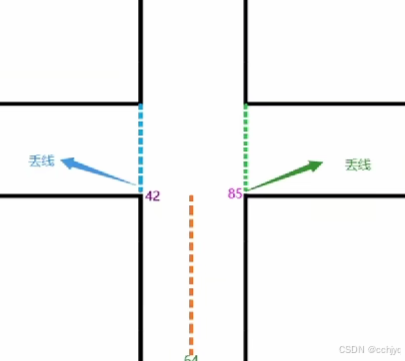
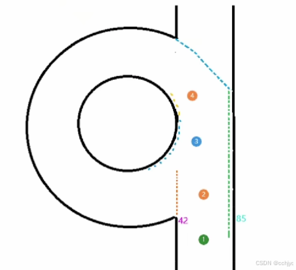
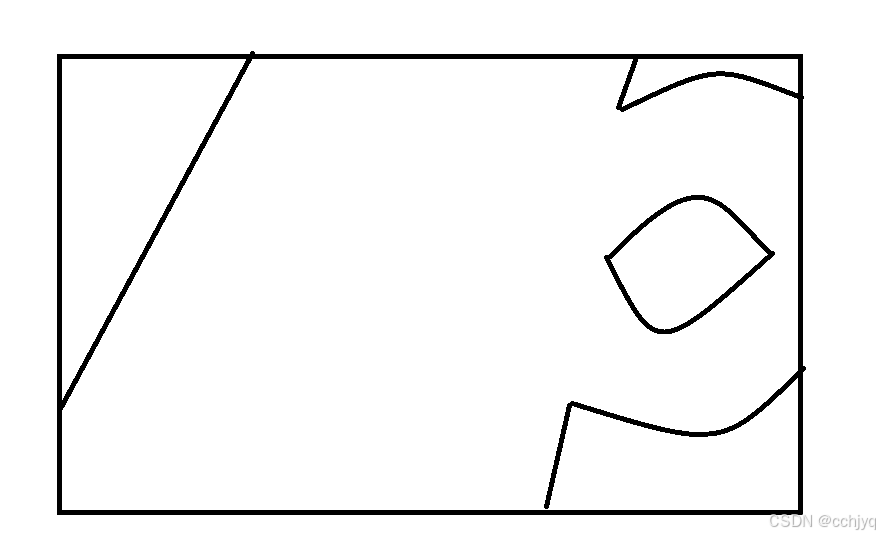

# 智能车镜头组入门（四）元素识别

> **原文**：[https://blog.csdn.net/chq66666/article/details/142364610](https://blog.csdn.net/chq66666/article/details/142364610)
> **作者**：chq66666（原创）
> **发布时间**：2024-09-19 18:03:47　|　**最后修改**：2026-01-19 10:39:22
> **数据**：阅读 6.3k　|　收藏 136　|　点赞 48
> **抓取保存**：2026-11-15 07:14　|　配图已存本地 `assets/element_blog_142364610/`，离线可读

---

元素识别是摄像头部分中难度最大的一部分，也是我花时间最长的一部分，前前后后画了很长时间，最后还是勉勉强强完成了。

基础的元素识别主要有两个：十字，圆环，和斑马线。十字要求直行，圆环需要进圆环。我们的车在完全不处理的情况下，十字可以猛冲过去，只是会非常抖（因为进去的时候两边存在丢线）。圆环不能进。

如果十字不能走直线的话，是直接判失败的，因为你抄了近路。圆环不能进入的话，罚时30s秒，我们这一年（19届）华南赛区一等奖是要在10s之内的，区2也要15s左右。所以如果你吃了这个罚时，基本上与区二无缘了。

前面我的推文提到过，我们在搜线搜完之后会额外出现两个数组，一个是左右边线的丢线数组，另一个是赛道宽度的数组。我们先对左右边线丢线数组进行处理：

```cpp
    loss_pointer_L = -1;
    loss_pointer_R = -1;
    if (loss_array[IMG_H - 1][0] == 1) {
        loss_array_L[++loss_pointer_L] = IMG_H - 1;
    }
    if (loss_array[IMG_H - 1][1] == 1) {
        loss_array_R[++loss_pointer_R] = IMG_H - 1;
    }
    for (int j = IMG_H - 1; j > IMG_H - max_length; j--) {
        if (loss_array[j - 1][0] == 1 && loss_array[j][0] == 0) { // head
            loss_array_L[++loss_pointer_L] = j;
        }
        if (loss_array[j - 1][0] == 0 && loss_array[j][0] == 1) { // end
            loss_array_L[++loss_pointer_L] = j - 1;
            loss_counter_L[loss_pointer_L / 2] = loss_array_L[loss_pointer_L - 1] - loss_array_L[loss_pointer_L];
        }
        if (loss_array[j - 1][1] == 1 && loss_array[j][1] == 0) { // head
            loss_array_R[++loss_pointer_R] = j;
        }
        if (loss_array[j - 1][1] == 0 && loss_array[j][1] == 1) { // end
            loss_array_R[++loss_pointer_R] = j - 1;
            loss_counter_R[loss_pointer_R / 2] = loss_array_R[loss_pointer_R - 1] - loss_array_R[loss_pointer_R];
        }
    }
```

这其中，loss\_array[IMG\_H][2]中存的是丢线的数据，比如左边线的第100行丢线了，则loss\_array[100][0] = 1。

这串代码的意图是把这个loss\_array分成四个一维数组，分别为loss\_array\_L，loss\_array\_R，loss\_counter\_L，loss\_counter\_R。loss\_array\_L[]这个数组偶数存放的是左边线丢线的开始，奇数存放的是 左边线丢线的结束，loss\_counter\_L[]这个数组存放的是左边线丢线的个数。便于之后辨别元素。例如loss\_array\_L[0] = 75, loss\_array\_L[1] = 55,那么说明左边线的55行-75行存在丢线的情况，那么 loss\_counter\_L[0]的值则为20。

所需要的另一个数组则为宽度的计算

我们首先需要计算在大直道的情况下，如果把车至于赛道中央，顶端和最低端赛道的像素数量

```cpp
    for (i = IMG_H - 1; i >= 0; i--) {
        compared_array[i] = (HEAD_LENGTH + (END_LENGTH - HEAD_LENGTH) * (float)i / IMG_H) * ELEMENT_RATE;
        if (boundary_length[i] > compared_array[i]) {
            elem_array[i] = 1;
        }
        else {
            elem_array[i] = 0;
        }
    }
```

这样我们可以计算出大直道上理论上的赛道宽度，如果大于这个宽度\*ELEMENT\_RATE，则有进元素的嫌疑。

之后我们还是像刚刚处理丢线的方式，来把丢线的长度入栈，

```cpp
    for (int j = ELEM_SEARCH_BEGIN; j > IMG_H - max_length; j--) {
        if (elem_array[j - 1] == 1 && elem_array[j] == 0) { // 开始
            elem[++elem_pointer] = j;
            line_L[elem_pointer] = abs(boundary[j][LEFT] - boundary[j - 1][LEFT]);
            line_R[elem_pointer] = abs(boundary[j][RIGHT] - boundary[j - 1][RIGHT]);

        }
        if (elem_array[j - 1] == 0 && elem_array[j] == 1) { // 结束
            elem[++elem_pointer] = j - 1;//结尾入栈
            elem_counter[elem_pointer / 2] = elem[elem_pointer - 1] - elem[elem_pointer];
            line_L[elem_pointer] = abs(boundary[j - 1][LEFT] - boundary[j][LEFT]);
            line_R[elem_pointer] = abs(boundary[j - 1][RIGHT] - boundary[j][RIGHT]);
        }
    }
    if (elem_array[1] == 1) {                                         //如果图象底部缺线 则将底部入栈
        elem[++elem_pointer] = 1;
        elem_counter[elem_pointer / 2] = elem[elem_pointer - 1] - elem[elem_pointer];
        line_L[elem_pointer] = abs(boundary[1][LEFT] - boundary[0][LEFT]);
        line_R[elem_pointer] = abs(boundary[1][RIGHT] - boundary[0][RIGHT]);
    }
```

这样，我们就完成了数据的预处理。

我们来具体分析下十字和圆环的特征。





图片是选用逐飞对ccd组进行讲解的图，对上面的标号对镜头组其实不适用，可以忽略

我们可以看出，临近十字有一条很长的直线，圆环的一侧是一条很长的直线，我们可以用这个来辅助判断圆环和十字的特征

然后圆环的入口和出口会有一个很大的丢线区域，十字中也会有一个很大的丢线区域

所以，我们需要一个函数来判断是否为直线

```cpp
unsigned char is_straight(unsigned char begin, unsigned char end, line_type line);//直线判断函数
```

我们的函数接受三个数据，读取boundary数组的line行，也就是确定左边线还是右边线。其他的有begin end  返回值是1或者0。

现在，我们来开始元素判断

```cpp
    if (mode == NORMAL && max_length > 95) {

        if (elem_pointer > 0) {
            i = 0;
            while (i <= elem_pointer && i < 10) {
                int lc = 0, rc = 0, llc = 0, rlc = 0, lcbegin = 0, rcbegin = 0;//l counter(long), l loss counter
                if(elem[i] - elem[i + 1] < 20) return;
                for(int a = 0; a < loss_pointer_L; a += 2){
                    llc += loss_counter_L[a / 2];
                    if(loss_counter_L[a / 2] > 25){
                        lc++;
                        lcbegin = loss_array_L[a];
                    }

                }
                for(int b = 0; b < loss_pointer_R; b += 2){
                    rlc += loss_counter_R[b / 2];
                    if(loss_counter_R[b / 2] > 25){
                        rc++;
                        rcbegin = loss_array_R[b];
                    }

                }
```

这部分是基础的判断，把丢线再次分为了长丢线和短丢线，这是一个很方便的分辨圆环和十字的方式，即圆环为一边的长丢线，十字为两边都有长丢线。

先来进行圆环的判断，前面有提到，圆环的一个很显著的特征是一侧边线为直线，但是实际你的图象不可能特别完美，比如可能会出现这样的情况：



显然 左边线的处理会比较困难，另外，可能由于光照之类的因素，左边线并不是非常的完整的直线，所以需要将左边线简单的做一下分割，分段判断是否为直线，方式和前文提到的数据预处理相差不大

```cpp
if(loss_array_R[0] == IMG_H - 1){//在底部丢线的情况下 排除底部
    for(int j = 1; j <= loss_pointer_R; j += 2){
        straight_judge_array[++straight_pointer] = loss_array_R[j];
        straight_judge_array[++straight_pointer] = loss_array_R[j + 1];
        if(loss_array_R[j + 1] < 20){
            straight_judge_array[straight_pointer] = 20;
            break;
        }
    }
}
else
{
    straight_judge_array[++straight_pointer] = IMG_H - 1;
    straight_judge_array[++straight_pointer] = loss_array_R[0];
    for(int j = 1; j <= loss_pointer_R; j += 2){
        straight_judge_array[++straight_pointer] = loss_array_R[j];
        straight_judge_array[++straight_pointer] = loss_array_R[j + 1];
        if(loss_array_R[j + 1] < 20){
            straight_judge_array[++straight_pointer] = 20;
            break;
        }
     }
}
```

然后，进行数据的筛除，把那些特别小的段进行剔除，之后可以进行直线判断

```cpp
for(int j = 1; j <= straight_pointer; j++){
    if(straight_pointer <= 2) break;
    if(straight_judge_array[j + 1] - straight_judge_array[j] > 5) flag = 0;
    if(abs(boundary[straight_judge_array[j + 1]][RIGHT] - boundary[straight_judge_array[j]][RIGHT])> 5) flag = 0;
    }
for(int j = 0; j <= straight_pointer; j += 2){
    if(!is_straight(straight_judge_array[j], straight_judge_array[j + 1], RIGHT)){
        flag = 0;
        break;
    }
}
```

这样判断后，圆环基本上可以实现识别到圆环了

```cpp
if(flag == 1){
    if(system_time - last_elem_finish_flag < 200)	return;
    if(circle_num_L == 0){
        return;
    }
    else{
        mode = FAR_CIRCLE_L;
    }
}
```

一种比较鸡贼的避免误判的方式 就是把根据赛道把圆环数量写死，也就是代码中的circle\_num\_L，需要注意每一次发车的时候都需要重置这个值

当然还有一些比较特殊的情况，需要另外加判断去屏蔽，这些需要大家跑车的时候多去试试。

圆环是误判最麻烦的一部分，因为圆环分成了好几个状态，每个状态都需要不同的补线方式，我们采用的出圆环的方式是陀螺仪的积分，这样就要求小车必须转一圈才会出圆环，所以一旦误判圆环就会造成直接的错误。

接下去是十字识别

```cpp
if(lc && rc){
    if(abs(lcbegin - rcbegin) > 20) return;
    l_down = elem[i]; r_down = elem[i];
    l_up = elem[i + 1]; r_up = elem[i + 1];
    for(int k = 10; k >= 0; k = k - 2){
        if(k > loss_pointer_L) continue;
        if(elem[i] - 3 < loss_array_L[k] && loss_counter_L[k / 2] > 5 && loss_array_L[k] != IMG_H - 1){
            l_down = loss_array_L[k] + 3;
            l_up = loss_array_L[k + 1] - 7;
            break;
        }
    }
    for(int k = 10; k >= 0; k = k - 2){
        if(k > loss_pointer_R) continue;
        if(elem[i] - 3 < loss_array_R[k] && loss_counter_R[k / 2] > 5 && loss_array_R[k] != IMG_H - 1){
            int a;
            r_down = loss_array_R[k] + 3;
            for(int b = 7; b < 13; b++){
                if(boundary[loss_array_R[k + 1] - b][RIGHT] < IMG_W - 5){
                    r_up = loss_array_R[k + 1] - b;
                    break;
                }
            }
            break;
        }
    }
    if(is_straight( l_down, l_down + 15, LEFT) && is_straight( r_down, r_down + 15, RIGHT)){
        mode = FAR_CROSS;
        return;
    }

}
```

十字识别相对来说简单些，两边都有长丢线：两边丢线到底端都是直线，而且直线误判也没关系，状态机会很快的恢复到正常模式，也不用单独调整权重。所以我们并没有在直线判断上下很多功夫

---

## 附：配图原始地址

1. https://i-blog.csdnimg.cn/direct/a11c6214b5cf4a12be4c7ebf9a38085c.png
2. https://i-blog.csdnimg.cn/direct/3a1c1b33adff48c5bfb956a7f953f771.png
3. https://i-blog.csdnimg.cn/direct/7e21853c917449a4a0ac6e887a128ce9.png

> 本文为原文正文的完整转录（含代码块与配图），文字与代码未做改写；仅补了上述元信息、本地图片路径，并把原文中并排的两张图拆成独立行以便阅读。
